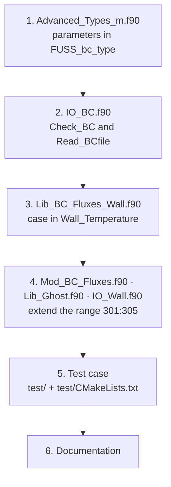

# Contributing

This page describes how to prepare a change to FUSS: workflow, build, code conventions, and the files to touch for the most common extensions.

---

## Workflow

1. Create a branch from `main`.
2. Make small commits. Subjects in the history are short and usually start with the area changed (`Ghost fill: ...`, `Tests: ...`, `BC 303: ...`).
3. Build and run the tests (see [Testing](testing.md)).
4. Push the branch and open a pull request.

---

## Development build

```bash
git clone https://github.com/open-hydra/FUSS.git
cd FUSS
./install.sh build --compilers=gnu --use-openmp --use-mpi   # first build, writes CMakePresets.json
./install.sh compile                                        # after each change
```

`install.sh` always builds `RELEASE`. For a debug build (`-O0`, warnings, traceback, bounds checking) reconfigure `build/` by hand:

```bash
cmake -B build -DCMAKE_BUILD_TYPE=DEBUG
cmake --build build
```

`./install.sh compile` reapplies the preset and so returns to `RELEASE`. `./install.sh update --remote` moves the submodules to the latest commits of their remotes, away from the commits recorded in FUSS. See [Installation](../getting-started/installation.md).

---

## Code conventions

These are the conventions the current sources follow:

- One module per `.f90` file, named `FUSS_` plus the file name (the exceptions are listed in [Code Structure](structure.md#naming)). New files under `src/lib/` are picked up by CMake without editing `CMakeLists.txt`.
- `implicit none` in every module; kinds from `iso_fortran_env`, as `use iso_fortran_env, only: I4 => int32, R8 => real64`.
- Sources are preprocessed (`-cpp`): MPI code sits in `#ifdef USE_MPI`; OpenMP is used only through `!$omp` directives.
- **OpenMP.** `Explicit_Step` opens one `!$omp parallel` region around the Runge–Kutta stages. The routines it calls (`Fill_Ghost_Cell`, `Fluxes`, `BC_Fluxes`, `RK_Newstate`) contain orphaned `!$omp do` loops, and MPI calls go in `!$omp single`. A new loop on that path follows the same pattern.
- **MPI.** Every loop over blocks skips the blocks of other ranks with `is_local_block(b)` (`Mod_MPI`). Global quantities use the reductions of `Mod_MPI`; output is gathered on rank 0. Results must not depend on the number of ranks: the `needs-mpi` tests compare the files of 1 process and 2 ranks.
- **Input keys.** A key is declared once with `reg%add(section, key, variable, default, description, allowed, required)` in `config/Register_*.f90`. After adding or changing one, regenerate the parameter table from the repository root with `bin/DocGen` (it writes `docs/user/registry.md`).
- Comments in English.

---

## Adding a wall boundary condition

The wall conditions 301–305 share one routine, `Wall_Temperature` in `src/lib/numerics/fluxes/bc/Lib_BC_Fluxes_Wall.f90`. It splits the face gradient into a normal part, from $T_w - T$ across the half cell, and tangential parts from the cells along the face, so the heat flux into the solid is

$$q_\text{in} = G\,(T_w - T) + C, \qquad G = 2k\,\nabla\xi_n\cdot\mathbf{n},$$

with $C$ the tangential (cross-diffusion) term. 302 prescribes $T_w$; 301, 303, 304 and 305 prescribe $q_\text{in} = q + h\,(T_\text{ref} - T_w) + \varepsilon\sigma\,(T_\text{ref}^4 - T_w^4)$ and solve for $T_w$ by Newton iteration. A new wall model with code `30x`:



1. **Data.** Add the model's parameters to `FUSS_bc_type` in `src/lib/base/Advanced_Types_m.f90`, with default 0.
2. **Parsing**, `src/lib/io/IO_BC.f90`:
    - `Check_BC`: add the code to the types followed by one data line (`case(101,301,302,303,304,305,103)`).
    - `Read_BCfile`: add a `case` that reads the data line into the new fields, increments `nwall` and sets `obj_io_bc%viscous_flag(b,f)`; the flag puts the face in the wall output.
3. **Model**, `Wall_Temperature`: add a `case`. A flux of the form above only needs `q`, `h`, `es` ($\varepsilon\sigma$) and `Tref`; the Newton loop then returns `Tw` and `q_in`. Any other model must return `Tw` and `q_in` consistent with $q_\text{in} = G\,(T_w - T) + C$.
4. **Dispatch**: extend the range `301:305` where the wall routine is selected:
    - `BC_Fluxes` in `src/lib/numerics/fluxes/bc/Mod_BC_Fluxes.f90` (`BC_Wall`: residual $-A\,q_\text{in}$);
    - `Fill_Ghost_Cell` in `src/lib/numerics/space/Lib_Ghost.f90` (`Ghost_Wall`: ghosts $2T_w - T$; time tables of 301/302 are evaluated there);
    - `Extract_Properties_From_BC` in `src/lib/io/IO_Wall.f90` (`Tw` and `qw` in `wall.tec`).
5. **Test.** Add a case with an exact or reference solution and register it in `test/CMakeLists.txt` (see [Testing](testing.md#adding-a-case)). A linear temperature field is reproduced exactly by the wall treatment; `test/steady-state/skewed_Plate` checks this for 301, 302, 303 and 305 on a sheared mesh and is a starting point.
6. **Documentation**: [Boundary Conditions](../user/boundary-conditions.md), [Governing Equations](../theory/governing-equations.md), and a V&V page.

ATLAS writes `bc.txt` from the wall sections of `input.ini` (`builder_300.f90` in the ATLAS repository); until it knows the new code, the test case writes `bc.txt` by script.

A boundary type that is not a wall also needs its ghost fill in `Fill_Ghost_Cell` (the default case mirrors the interior cells), its flux in `BC_Fluxes` (types without a case add no flux), and, if it reads cells of other blocks, an entry in the MPI exchange of `Mod_GhostExchange`.

---

## Adding a material

No code change is needed. Materials are tables in `INPUT/properties.dat`, one Tecplot zone per material in the order of the names in `INPUT/phase.txt`; the `matID` field of `ic.tec` selects the material of each cell.

- Columns: Temperature, Cp, Density, Conductivity, Energy, in 1 K steps; every zone covers the same temperature range (FUSS takes it from the first zone).
- Energy must be $h = \int \rho c_p\, dT$: FUSS warns when it departs from it by more than 1 %.
- The range must contain every temperature reached in the run.

ATLAS builds the tables from the `[GPB-*]` sections. See [Material Properties](../theory/thermo.md).

---

## Documentation

The site is built with MkDocs and mkdocs-material (plus mkdocs-macros-plugin). A new page goes into the `nav` of `mkdocs.yml`. The GitHub workflow `.github/workflows/docs.yml` builds it with

```bash
mkdocs build --strict
```

which must pass.

---

## Pull request checklist

- [ ] Builds without and with `--use-openmp --use-mpi`.
- [ ] `ctest --test-dir build -L fast` passes; with MPI, `ctest --test-dir build -L needs-mpi` too.
- [ ] New behaviour has a test case registered in `test/CMakeLists.txt`.
- [ ] `docs/user/registry.md` regenerated with `bin/DocGen` if input keys changed.
- [ ] Documentation updated; `mkdocs build --strict` passes.
