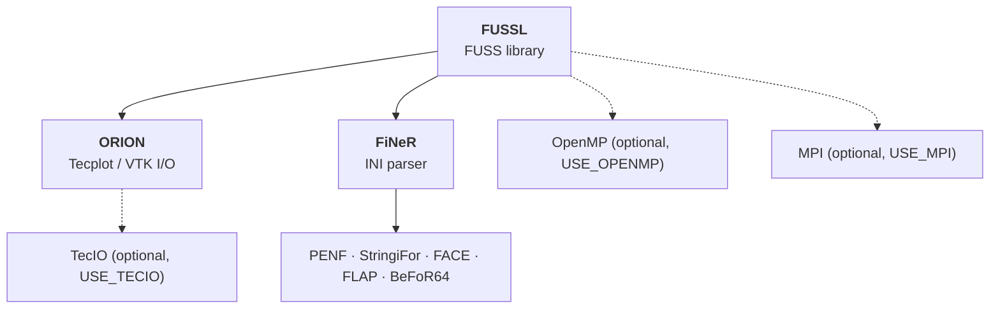
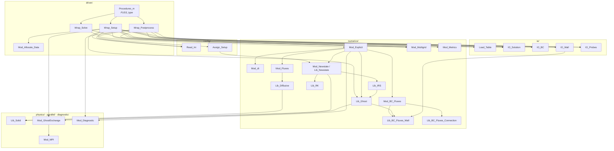
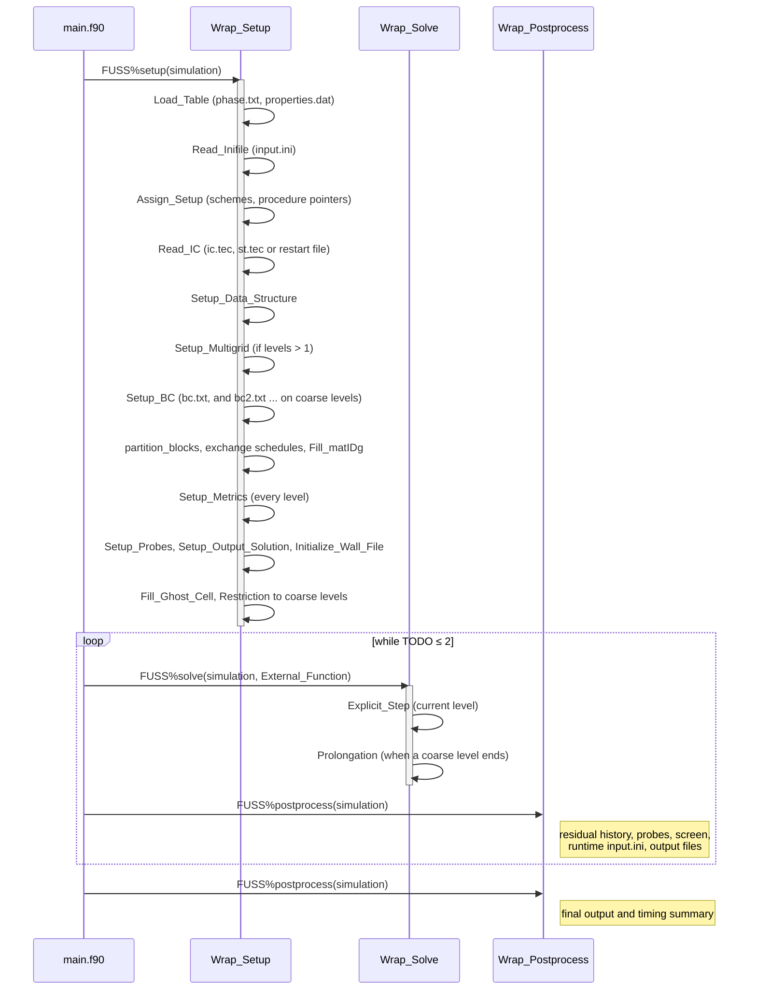
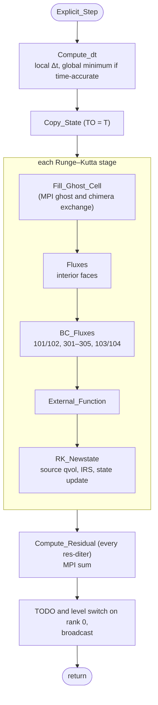
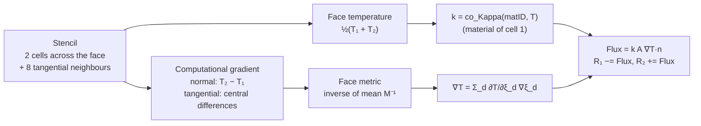
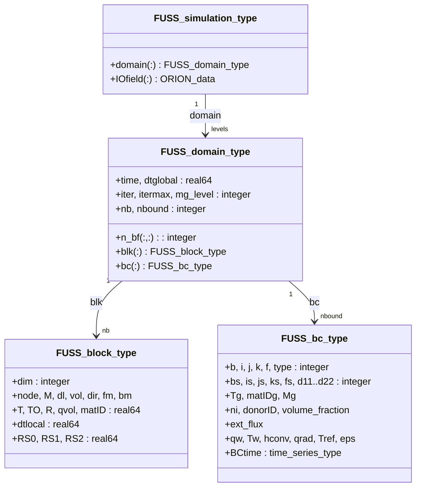

# Code Structure

This page describes the repository layout, the modules of the FUSS library and the order in which the solver calls them.

---

## Repository layout

```
FUSS/
├── CMakeLists.txt        # top-level build: ORION, FiNeR, src/lib, src/app, test
├── install.sh            # build / compile / update
├── mkdocs.yml            # documentation site
├── cmake/                # compiler flags, OpenMP/MPI detection
├── src/
│   ├── app/
│   │   ├── main.f90      # solver executable (bin/FUSS)
│   │   └── docgen.f90    # writes docs/user/registry.md (bin/DocGen)
│   └── lib/              # FUSS library (FUSSL), see below
├── lib/
│   ├── ORION/            # submodule: Tecplot/VTK I/O, bundles TecIO
│   └── third_party/
│       ├── FiNeR/        # submodule: INI parser
│       └── PENF/ FACE/ FLAP/ BeFoR64/ StringiFor/   # submodules: FiNeR's libraries, added by CMake before FiNeR
├── test/
│   ├── CMakeLists.txt    # CTest definitions
│   ├── run_case.sh       # runs one case for CTest
│   ├── steady-state/     # verification cases
│   ├── transient/        # verification cases
│   └── numerics-features/# chimera, residual convergence, parallel timing
└── docs/                 # MkDocs sources
```

`bin/`, `build/` and `CMakePresets.json` are created by the build and ignored by git.

---

## Library sources

| Directory | Files | Content |
|-----------|-------|---------|
| `base/` | `Parameters_m`, `Global_m`, `Base_Types_m`, `Advanced_Types_m`, `Series_Data_m`, `Finite_m` | Constants, ghost layers `gc` and dimensions `ndir`, block/domain/BC types, time tables of BCs 301/302, test of a value for NaN and infinities (`Not_Finite`) |
| `config/` | `Config_Types_m`, `Registry`, `Backend_INI`, `Read_Ini`, `Register_Sim_Param`, `Register_IO`, `Register_Numerics`, `Assign_Setup` | Settings objects (`obj_*`), `input.ini` key registry and reader, scheme selection |
| `driver/` | `Procedures_m`, `Wrap_Setup`, `Wrap_Solve`, `Wrap_Postprocess`, `Mod_Allocate_Data` | `FUSS_type` with `setup`, `solve`, `postprocess`; allocation |
| `io/` | `Load_Table`, `IO_Solution`, `IO_BC`, `IO_Wall`, `IO_Probes` | Property tables, initial condition and solution files, `bc.txt`, wall output, probes |
| `numerics/fluxes/` | `Mod_Fluxes`, `Lib_Diffusive` | Interior diffusive fluxes |
| `numerics/fluxes/bc/` | `Mod_BC_Fluxes`, `Lib_BC_Fluxes`, `Lib_BC_Fluxes_Connection`, `Lib_BC_Fluxes_Wall` | Boundary fluxes: dispatch, face helpers, block connection and chimera (101, 102), walls (301–305) |
| `numerics/space/` | `Mod_Metrics`, `Lib_Metrics`, `Lib_Stencil_Metrics`, `Lib_Ghost` | Metrics, face normals and areas; stencil face metrics (`diffusive-metric = stencil`); ghost-cell fill for every BC type |
| `numerics/time/` | `Mod_dt` | Local and global time step |
| `numerics/time/explicit/` | `Mod_Explicit`, `Mod_Newstate`, `Lib_Newstate`, `Lib_RK`, `Lib_IRS` | Iteration loop, state update (`cons`/`prim`), Runge–Kutta stages, residual smoothing |
| `numerics/multigrid/` | `Mod_Multigrid`, `Lib_Multigrid`, `Mod_FAS` | Coarse levels, restriction, prolongation; FAS V and W cycles |
| `parallel/` | `Mod_MPI`, `Mod_GhostExchange`, `Mod_Timers` | MPI set-up, block partition, reductions, the stops of the errors (`mpi_stop_all`, `mpi_stop_if_any`, `stop_from_thread`); ghost and chimera exchange, gathers to rank 0; wall-clock timers |
| `physics/` | `Lib_Solid` | Property interpolation `co_Kappa`, `co_Rho`, `co_Cp`, `co_H` and inversion `co_T` |
| `diagnostic/` | `Mod_Diagnostic` | Residual norm, `diagnostic.tec` |

All files are `.f90`. `src/lib/CMakeLists.txt` collects every `.f90` under `src/lib/` with `GLOB_RECURSE`.

---

## Dependencies



---

## Module dependencies

The main `use` relations between the modules (every module also uses `base/` and most use `Config_Types_m`; module names carry the prefix `FUSS_`, omitted here):



---

## Naming

| Pattern | Use | Example |
|---------|-----|---------|
| `FUSS_` | Prefix of every module name | `FUSS_Mod_Fluxes` in `Mod_Fluxes.f90` |
| `Mod_*` | Mostly domain-level drivers and module state (procedure pointers, schedules) | `Mod_Fluxes`, `Mod_Newstate`, `Mod_GhostExchange` |
| `Lib_*` | Mostly routines on a block, face or cell | `Lib_Diffusive`, `Lib_BC_Fluxes_Wall`, `Lib_Solid` |
| `*_m` | Types and parameters | `Global_m`, `Config_Types_m` |
| `Wrap_*` | The three phases of `FUSS_type` | `Wrap_Setup` |
| `IO_*` | File input/output | `IO_Wall` |
| `obj_*` | Settings objects in `Config_Types_m` | `obj_time_scheme`, `obj_io` |
| `*_type` | Derived types | `FUSS_block_type` |

The module name is `FUSS_` plus the file name, except in `config/`: `Registry.f90` holds `FUSS_Input_Registry`, and `Register_IO.f90`, `Register_Numerics.f90`, `Register_Sim_Param.f90` hold `FUSS_Read_IO`, `FUSS_Read_Numerics`, `FUSS_Read_Sim_Param`. Routine names have no prefix.

---

## Solver pipeline

`src/app/main.f90` creates a `FUSS_type` object and a `FUSS_simulation_type`, calls `setup`, then alternates `solve` (one iteration) and `postprocess` while `obj_sim_param%TODO` ≤ 2, and calls `postprocess` once more at the end. `TODO` is 1 for a plain iteration, 2 when output is due or a multigrid level ends, 3 when the run ends.



The external subroutine passed to `solve` is called at every stage; `main.f90` passes an empty one, hydra uses it for the coupling.

### Explicit step



### Interior face flux

`Fluxes_blk` (`Mod_Fluxes`) loops over the faces of each direction and calls `Diffusive_Flux` (`Lib_Diffusive`):



See [Spatial Discretisation](../theory/numerics.md) for the formulas.

---

## Data structures



`domain(m)` is multigrid level `m` (1 = finest). `bc(:)` has one entry per boundary cell face, in the order of `bc.txt`.

| Array | Bounds | Content |
|-------|--------|---------|
| `T`, `TO` | `1-gc:n+gc` | Temperature, and its value at the start of the iteration |
| `R` | `1-gc:n+gc` | Residual (sum of face fluxes) |
| `qvol`, `matID` | `1-gc:n+gc` | Volumetric source; material index (stored as real) |
| `dtlocal` | `1:n` | Local time step |
| `RS0`, `RS1`, `RS2` | `1-gc:n+gc` | IRS work arrays (allocated with IRS only) |
| `M`, `dl`, `vol` | `1-gc:n+gc` | Metric (rows ∇ξ_d), cell lengths, volume |
| `fm(d)%Mf` | `1:n-1` along `d`, `1:n` in the others | Stencil face metric (3×3) of the interior face between a cell and the next one along `d` (`diffusive-metric = stencil`) |
| `bm(f)` | six block faces | Stencil metrics of the walls (`wM`) and of the block connections (`cM`) that the record owns |
| `node` | `0:n` | Grid nodes |
| `dir(d)%f` | faces normal to `d` | Unit normal `N` and area `A` |

---

## Build system

| Target | Type | Source |
|--------|------|--------|
| `FUSSL` (alias `FUSSL::FUSSL`) | Library (static by default) | `src/lib/**/*.f90` |
| `FUSS` | Executable, `bin/FUSS` | `src/app/main.f90` |
| `DocGen` | Executable, `bin/DocGen` | `src/app/docgen.f90` |

| Variable | Default | Effect |
|----------|---------|--------|
| `USE_OPENMP` | `OFF` | OpenMP |
| `USE_MPI` | `OFF` | MPI; defines the preprocessor symbol `USE_MPI` |
| `USE_TECIO` | `ON` (ORION option) | TecIO; `install.sh` passes `false` unless `--use-tecio` |
| `CMAKE_BUILD_TYPE` | `RELEASE` | `RELEASE`, `DEBUG` or `TESTING` (`cmake/SetFortranFlags.cmake`) |
| `ORION_PATH`, `FINER_PATH`, `FINER_DEPS_PATH` | `lib/ORION/`, `lib/third_party/FiNeR/`, `lib/third_party/` | Dependency source trees |

When FUSS is added to another CMake project (as in hydra) only `FUSSL` is built; the parent defines ORION and FiNeR. The executables and the tests are built only when FUSS is the top-level project. See [Installation](../getting-started/installation.md).
