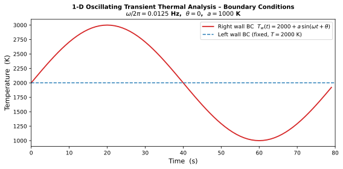
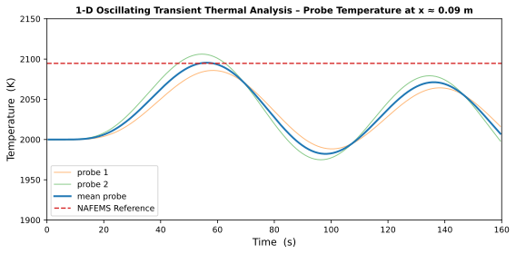

# 1-D Oscillating Rod

A rod starts at a uniform temperature. One end is held fixed and the other oscillates sinusoidally. The test checks the time
tables of a wall temperature, the time-accurate mode and the probes.

**Reference**: NAFEMS P16, *Benchmark Tests for Thermal Analysis*, Test 5, 1986.
Setup and run: `test/transient/oscillating_Rod/README.md`.

---

## Problem

A rod of length 0.1 m: k = 1 W/(m·K), ρ = 2300 kg/m³, cp = 985 J/(kg·K).

$$\rho c_p \frac{\partial T}{\partial t} = k \frac{\partial^2 T}{\partial x^2}$$

| Face | Condition |
|---|---|
| x = 0 | T = 2000 K (0 °C in NAFEMS) |
| x = 0.1 m | T(t) = 2000 + 1000 sin(2π f t) K, f = 0.0125 Hz (period 80 s) |
| lateral | adiabatic |

The rod starts at 2000 K. The quantity checked is the largest rise above 2000 K at x = 0.09 m,
within two periods (160 s).

The diffusivity is $\alpha = k/(\rho c_p) \approx 4.41 \times 10^{-7}$ m²/s. The penetration depth of
the oscillation is

$$\delta = \sqrt{\frac{\alpha}{\pi f}} \approx 3.35\ \text{mm}$$

so the point lies about three penetration depths from the oscillating end: the response is strongly
damped.

## Result

Two probes sit on either side of x = 0.09 m; their mean is compared with NAFEMS.

| Location | NAFEMS | FUSS (mean of the probes) | Error |
|---|---|---|---|
| x = 0.09 m | 94.69 K | 95.449 K | +0.80 % |

The tolerance is 1 %. The exact solution of this setup peaks at 96.60 K at t ≈ 56.5 s
(Crank–Nicolson on 1600 cells, converged to 0.1 K). FUSS is 1.2 % below it: with Δx = 1 mm the
penetration depth spans only about three cells.
