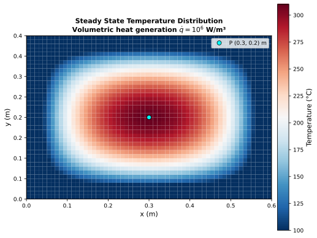

# 2-D Volumetric Heat Plate

A plate with a uniform heat source is held at 0 °C on all four edges. The test checks the volumetric source.

**Reference**: NAFEMS P16, *Benchmark Tests for Thermal Analysis*, Test 9 (ii), 1986.
Setup and run: `test/steady-state/qvol_Plate/README.md`.

---

## Problem

A plate of 0.6 m × 0.4 m, k = 52 W/(m·K), with a uniform source $\dot q = 10^6$ W/m³:

$$\frac{\partial^2 T}{\partial x^2} + \frac{\partial^2 T}{\partial y^2} + \frac{\dot{q}}{k} = 0$$

All four edges are at 0 °C (273.15 K). The maximum is at the centre, point B (x = 0.3 m,
y = 0.2 m), where NAFEMS gives 310.1 °C.

## Result

Point B lies where four cell centres meet. By symmetry all four hold 309.98 °C.

| Location | NAFEMS | FUSS | Error |
|---|---|---|---|
| B (0.3 m, 0.2 m) | 310.10 °C | 309.98 °C | 0.021 % |

The difference is 0.12 K, against a tolerance of 1 %.
