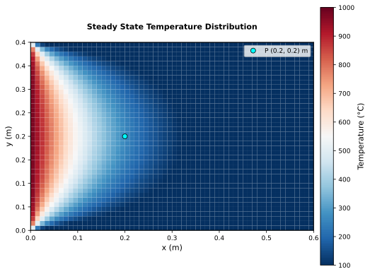

# 2-D Temperature Plate

A plate is held at 1000 °C on one edge and 0 °C on the other three. The test checks prescribed-temperature walls and the Laplace problem.

**Reference**: NAFEMS P16, *Benchmark Tests for Thermal Analysis*, Test 9 (i), 1986.
Setup and run: `test/steady-state/temperature_Plate/README.md`. The [Quick Start](../getting-started/quick-start.md)
walks through this case.

---

## Problem

A plate of 0.6 m × 0.4 m, k = 52 W/(m·K), no source:

$$\frac{\partial^2 T}{\partial x^2} + \frac{\partial^2 T}{\partial y^2} = 0$$

| Edge | Condition |
|---|---|
| left (x = 0) | T = 1000 °C (1273.15 K) |
| right, bottom, top | T = 0 °C (273.15 K) |

The reference is the temperature at point A (x = 0.2 m, y = 0.2 m): 260.5 °C.

## Result

Point A lies where four cell centres meet, so the bilinear interpolation is their mean.

| Cell centre (m) | T (°C) |
|---|---|
| (0.195, 0.195) | 270.48 |
| (0.205, 0.195) | 250.54 |
| (0.195, 0.205) | 270.48 |
| (0.205, 0.205) | 250.54 |

| Location | NAFEMS | FUSS | Error |
|---|---|---|---|
| A (0.2 m, 0.2 m) | 260.50 °C | 260.51 °C | 0.0017 % |

The difference is 0.009 K, against a tolerance of 1 % (in kelvin).
