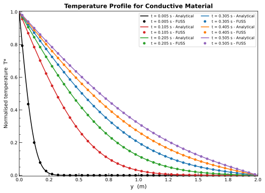

# 2-D Multi-Material Plate

A conductive layer lies between two insulating ones, and heat diffuses across it. The test checks transient conduction and block connections between two materials.

**Reference**: LANL report, *Some New Verification Test Problems for Multi-Material Diffusion on
Meshes that are Non-Aligned with Material Interfaces*.
Setup and run: `test/transient/multimat_Plate/README.md`.

---

## Problem

A plate of 2 m × 2 m in three blocks along x:

| Block | x (m) | Material | k (W/mK) | ρ, cp |
|---|---|---|---|---|
| 1 | −1.0 to −0.25 | insulator | 10⁻¹² | 1, 1 |
| 2 | −0.25 to 0.25 | conductor | 1 | 1, 1 |
| 3 | 0.25 to 1.0 | insulator | 10⁻¹² | 1, 1 |

The bottom (y = 0) is held at 101 K, the top (y = 2 m) at 100 K; the outer x faces are adiabatic.
The plate starts at 100 K. No heat enters the insulators, so block 2 is a 1-D transient problem in
y with α = 1 m²/s.

With $T^* = (T - 100)/(101 - 100)$ and L = 2 m:

$$\frac{\partial T^*}{\partial t} = \alpha \frac{\partial^2 T^*}{\partial y^2}, \quad T^*(0, t) = 1, \quad T^*(L, t) = 0, \quad T^*(y, 0) = 0$$

The solution is a linear steady profile plus a decaying Fourier series:

$$T^*(y, t) = 1 - \frac{y}{L} - \sum_{r=1}^{\infty} \frac{2}{r\pi} \sin\!\left(\frac{r\pi y}{L}\right) \exp\!\left(-\frac{r^2\pi^2\alpha t}{L^2}\right)$$

The check uses 100 terms.

## Result

Profiles along y in the middle of block 2 at six times. Circles: FUSS; lines: exact.

| t (s) | L∞ error | L2 error |
|---|---|---|
| 0.005 | 0.017700 | 0.003664 |
| 0.105 | 0.000775 | 0.000352 |
| 0.205 | 0.000396 | 0.000212 |
| 0.305 | 0.000267 | 0.000159 |
| 0.405 | 0.000205 | 0.000133 |
| 0.505 | 0.000171 | 0.000118 |

Errors are in units of the temperature step; the tolerance is 0.02. The largest error is at
t = 0.005 s. The diffusion length is then √(αt) ≈ 0.07 m, about one cell (Δy = 0.05 m), so the
steep front is under-resolved. From t = 0.1 s on every error is below 0.001.
