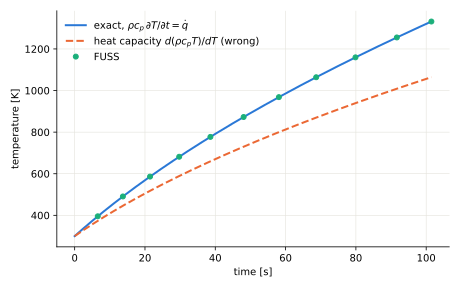

# 2-D Transient Variable-cp Plate

Uniform heating of an adiabatic plate whose specific heat grows linearly with temperature.  With every wall adiabatic and a uniform volumetric source the temperature stays uniform, conduction plays no part, and the heat equation reduces to an ordinary differential equation with a closed-form solution.  The case therefore isolates the **heat capacity** of the time update: it is the test for temperature-dependent $\rho\,c_p$ on both integration paths (`prim` and `cons`, see [Governing Equations](../theory/governing-equations.md#state-vector)).

**Reference**: closed-form solution (below).  Test folder: `test/transient/variable_cp_Plate`.

---

## Problem setup

The geometry and mesh are those of the [Volumetric Heat Plate](2D-steady-state-qvol-plate.md): a 0.6 m × 0.4 m plate, one block of 60 × 40 cells, 2-D plane.

| Item | Value |
|---|---|
| Walls (faces 1–4) | adiabatic, prescribed flux $q = 0$ (code 301) |
| Faces 5–6 | `null` (2-D plane) |
| Initial temperature | $T_0 = 300$ K, uniform |
| Volumetric source | $\dot q = 5 \times 10^{7}$ W/m³, uniform |

**Material** (`make_properties.py` writes `INPUT/properties.dat`; ATLAS GPB writes constant-property tables only):

| Property | Value |
|---|---|
| Specific heat | $c_p(T) = A + B\,T$, $A = 300$ J/(kg·K), $B = 0.4$ J/(kg·K²): 420 at 300 K, 830 at 1330 K |
| Density | $\rho = 7850$ kg/m³ |
| Conductivity | $k = 52$ W/(m·K) |
| Energy column | $h(T) = \rho\,(A\,T + B\,T^2/2) = \int_0^T \rho\,c_p\,\mathrm{d}T'$ |

## Analytical solution

With a uniform field the heat equation reads $\rho\,c_p(T)\,\mathrm{d}T/\mathrm{d}t = \dot q$, that is $h(T) - h(T_0) = \dot q\,t$:

$$
\rho\left[A\,(T - T_0) + \frac{B}{2}\,(T^2 - T_0^2)\right] = \dot q\,t
\quad\Longrightarrow\quad
T(t) = \frac{-A + \sqrt{A^2 + 2B\,\bigl[h(T_0) + \dot q\,t\bigr]/\rho}}{B}
$$

An update that used $\mathrm{d}(\rho\,c_p\,T)/\mathrm{d}T = \rho\,(A + 2B\,T)$ as heat capacity would instead follow $\rho\,[A\,(T - T_0) + B\,(T^2 - T_0^2)] = \dot q\,t$, which `verify.py` shows for reference.

## Numerical setup

| Parameter | Value |
|---|---|
| Time scheme | RK3 |
| VNN | 0.8 |
| Time-accurate | true |
| Integration variables | primitive (the test input); conservative checked as well |
| Implicit residual smoothing | disabled |
| End time | `time-threshold` 100 s (the last step ends at 101.48 s) |
| Solution write interval | every 5 iterations (`sol-overwrite = false`) |

The time step grows from 1.27 s to 2.49 s as $\alpha = k/(\rho\,c_p)$ falls; the run takes 54 steps.

## Verification approach

`verify.py` reads every `OUTPUT/field*.tec`, takes the mean and the spread of the cell temperatures and the solution time, and compares the mean with $T(t)$.  It passes when the largest error is below $10^{-3}$ of the temperature rise and the field is uniform.  It also checks the stored energy, $h(T) - h(T_0)$ against $\dot q\,t$, and writes `2D-transient-variable-cp-plate.svg`.

## Results

| Build, integration variables | $T$ at 101.48 s | Error / temperature rise | Stored energy error | Result |
|---|---|---|---|---|
| since 2026-10-09, `prim` | 1331.880 K | 2.1 × 10⁻⁷ | 8.5 × 10⁻⁸ | PASS |
| since 2026-10-09, `cons` | 1331.880 K | 9.9 × 10⁻⁷ | −3.3 × 10⁻⁸ | PASS |
| before 2026-10-09, `prim` | 1059.09 K (end time 100.54 s; exact there 1324.72 K) | 0.26 | −0.32 | FAIL |
| before 2026-10-09, `cons` | 1331.880 K | 9.9 × 10⁻⁷ | −3.3 × 10⁻⁸ | PASS |

The exact temperature at 101.48 s is 1331.880 K; the spread across the plate is zero in every run.  Before 2026-10-09 the `prim` update divided by $\mathrm{d}(\rho\,c_p\,T)/\mathrm{d}T$ and followed the wrong curve exactly, while the `cons` path, which advances the Energy column, was already right.  A table whose Energy column holds $\rho\,c_p\,T$ instead of $\int\rho\,c_p\,\mathrm{d}T$ makes the `cons` path follow the wrong curve too (1059.09 K); FUSS warns about it when it loads the table (here: d$h$/d$T$ off $\rho\,c_p$ by 72.7 %).

