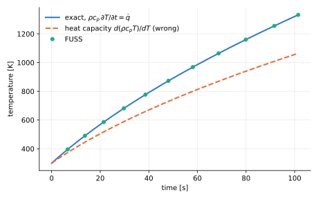

# 2-D Variable-cp Plate

An adiabatic plate is heated uniformly, and its specific heat grows linearly with temperature. The test checks the heat capacity of the time update with temperature-dependent $\rho\,c_p$, on both paths (`prim` and `cons`, see [Governing Equations](../theory/governing-equations.md#state-vector)).

Setup and run: `test/transient/variable_cp_Plate/README.md`.

---

## Problem

A plate of 0.6 m × 0.4 m with every wall adiabatic and a uniform source
$\dot q = 5 \times 10^{7}$ W/m³. It starts at $T_0 = 300$ K. The field stays uniform, so conduction
plays no part.

| Property | Value |
|---|---|
| Specific heat | $c_p(T) = A + B\,T$, A = 300 J/(kg·K), B = 0.4 J/(kg·K²): 420 at 300 K, 832 at 1330 K |
| Density | ρ = 7850 kg/m³ |
| Conductivity | k = 52 W/(m·K) |
| Energy column | $h(T) = \rho\,(A\,T + B\,T^2/2) = \int_0^T \rho\,c_p\,\mathrm{d}T'$ |

The heat equation reduces to $\rho\,c_p(T)\,\mathrm{d}T/\mathrm{d}t = \dot q$, that is
$h(T) - h(T_0) = \dot q\,t$:

$$
T(t) = \frac{-A + \sqrt{A^2 + 2B\,\bigl[h(T_0) + \dot q\,t\bigr]/\rho}}{B}
$$

A wrong heat capacity, $\mathrm{d}(\rho\,c_p\,T)/\mathrm{d}T = \rho\,(A + 2B\,T)$, would follow a
different curve; the check plots it for reference.

## Result

| Integration variables | T at 101.48 s | Error / temperature rise | Stored energy error |
|---|---|---|---|
| `prim` | 1331.880 K | 2.1 × 10⁻⁷ | 8.5 × 10⁻⁸ |
| `cons` | 1331.880 K | 9.9 × 10⁻⁷ | −3.3 × 10⁻⁸ |

The exact temperature is 1331.880 K, and the field stays uniform in every run. The tolerance is
10⁻³ of the temperature rise.

!!! warning "The Energy column must be the integral of ρ cp"
    A table whose Energy column holds $\rho\,c_p\,T$ instead of $\int\rho\,c_p\,\mathrm{d}T$ puts the
    `cons` path on the wrong curve, which ends near 1059 K here. FUSS warns when it loads
    such a table (here: d$h$/d$T$ off $\rho\,c_p$ by 72.7 %).
