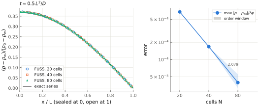
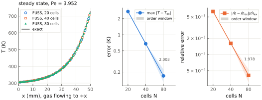
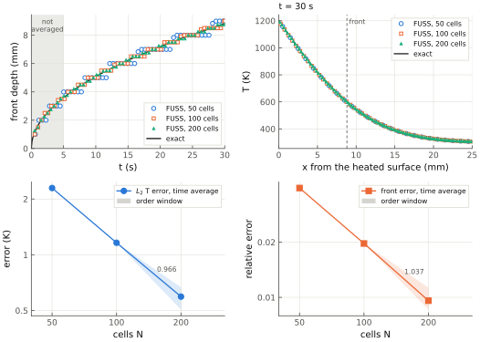

# Type-2 (Darcy) Gas Closure: Exact and Analytic Benchmarks

The type-2 gas closure solves a separate pressure field for the pyrolysis gas ($\Gamma = \rho_g K/\mu$,
$\rho_g = pW/(RT)$ ideal) and carries its storage and transpiration work in the energy equation. These
cases isolate the Darcy solve itself — steady and transient, isotropic and tensor permeability,
sealed and open faces, single- and multi-block, periodic faces — against closed-form or
numerically-exact solutions, independently of the pyrolysis kinetics (most run on frozen or
kinetics-stripped tables).

Setup and run: `test/pyrolysis/darcy/README.md`, `test/pyrolysis/exact/README.md`.

---

## Sealed, source-free slab

A 100-cell, 0.05 m slab (`darcy/sealed_nosource`), both faces impermeable (BC 301), no gas
production, uniform $T_0=1000$ K, $p_0=101325$ Pa. With no source and no open face the pressure
equation has the trivial exact solution $p\equiv p_0$: every face flux and velocity must be exactly
zero, and the run ends at its first material step (the step cap is 1: nothing moves, so the
convergence residual is exactly zero and one step is the whole test).

**Results** (`OUTPUT/field.tec`, `OUTPUT/darcy.txt`): max $\lvert p_{pg}-p_0\rvert/p_0\le10^{-14}$
(round-off of a zero-residual sweep); max $\lvert p_i-p_j\rvert$, max $\lvert\dot m_{pg}\rvert$, max
$\lvert u_{pg}\rvert$ all exactly 0; every `darcy.txt` step converges at `resid = 0` in at most the one
mandatory sweep; max $\lvert T-T_0\rvert\le10^{-9}$ K (no gas work since $p$ is constant).

---

## Steady mass balance on a 1-D line

`darcy/mass_balance_1d`: 100 cells, 0.05 m, face 1 sealed (BC 301), face 2 open (BC 303, `hconv = 0`,
`qrad = 0`, `Tref = 1000` K, so $p_w=101325$ Pa), a constant gas production `pi-source = 0.1`
kg/(m³·s), $K=10^{-11}$ m², constant synthetic gas, isothermal solid tables, $T_0=1000$ K. At steady
state mass conservation gives $\dot m(x) = \pi x$ at every face regardless of $T(x)$. Two variants:
`b2` (the committed case, 2 s time-accurate; the gas relaxation time $L^2/D_p\approx0.09$ s) and `b1`
(the gate's staged copy, `quasi-steady = true`: Picard iteration on the lagged $\Gamma$).

**Reference.** The face fluxes are rebuilt directly from `OUTPUT/field.tec` with the solver's own
discrete closure: cell $\Gamma_c = p_c WK/(RT_c\mu)$, face $\Gamma_f=(\Gamma_L+\Gamma_R)/2$, flux
$-\Gamma_f(p_R-p_L)/\mathrm dx$ (open face: $\Gamma_w=(\Gamma_N+\Gamma(p_w,T_N))/2$, flux
$-\Gamma_w(p_w-p_N)/(\mathrm dx/2)$), and compared with $\pi x_f$ at every face.

**Results.** Face-flux error $\max_f\lvert\dot m_f-\pi x_f\rvert/(\pi L)$: $\le10^{-9}$ (`b1`,
round-off of the exact line solve) or $\le10^{-6}$ (`b2`, the residual bound of the transient run); the
open-face flux from the energy budget's $M_{\rm gas,out}$ rate agrees with $\pi L$ to the same
tolerance; the energy identity $\lvert E(t)-E(0)+Q_{\rm out}-Q_{\rm src}\rvert\le10^{-10}\max(\lvert E_0\rvert,\lvert Q_{\rm out}\rvert)$
holds at every row; `darcy.txt` shows every step converged within the solver's own `tol` and exactly 1
sweep per step (a 1-D tridiagonal solve).

**Multi-block.** `darcy/mass_balance_1d_2x`: four identical copies of the line side by side along $j$
(instead of two), cut into 1×2 blocks of 100×2 cells each, forming one line-implicit correction group.
Measured (against the four-line, single-block source): $T$ relative $1.0\times10^{-14}$, $p_{pg}$ relative
$7.8\times10^{-14}$; the sweep counts over the first steps match the single-block run exactly
(5, 4, 4, 4, 3). `test/run_mpi_gate.sh` runs it at 2 MPI ranks against 1: every output byte-identical.

---

## Steady pressure profile and order of convergence

`darcy/sealed_profile/{N020,N040,N080,N160}`: sealed at $x=0$ (BC 301), $p=p_w=101325$ Pa at $x=L=0.05$ m
(BC 303, closed-form), constant `pi-source`, $T$, $\mu$, $W$ and $K=10^{-13}$ m² (the solid $c_p$ is
set to $10^{12}$ so $T$ stays frozen at 1000 K); the Darcy solver is the quasi-steady damped-Jacobi
`pseudo`.

**Reference.** With $\Gamma\propto p$, the steady equation is linear in $p^2$:

$$
p^2(x) = p_w^2 + \frac{\pi RT\mu}{WK}\bigl(L^2-x^2\bigr).
$$

**Results.** The $L_\infty$ error against this profile decreases monotonically over the four grids,
with observed order 1.942, 1.969, 1.984 on the three successive pairs (central flux of $p^2$ with a
half-cell Dirichlet closure: second order).

**Klinkenberg correction.** The same four grids with `klinkenberg = true`, $B=bK/\mu$,
$b=p_w/2$: FUSS's effective permeability is $K_{\rm eff}=K+(\mu/p)B$ (the same law as the literature's
$K(1+\beta/p)$ with $\beta=\mu B/K$ at constant $\mu$; Wu, Pruess & Persoff, 1998, eq. 3.2, for the
steady form). With $\Gamma\propto(p+b)$, $p+b$ obeys the plain equation exactly:

$$
(p+b)^2 = (p_w+b)^2 + \frac{\pi RT\mu}{WK}\bigl(L^2-x^2\bigr).
$$

Observed order 1.972, 1.986, 1.993 on the three pairs; the term moves the profile by 23 kPa at the
wall, about $19\,000\times$ the finest grid's own error, confirming the correction is active and not a
no-op.

**Pass criteria** (both variants): the error decreases monotonically over the four grids and the
observed order on the finest pair is $\ge1.9$; every run's last Picard/Jacobi increment is
$\le10^{-10}$ relative and the run reaches its iteration cap exactly; max $\lvert T-T_0\rvert\le10^{-6}$ K
on every grid. The Klinkenberg variant additionally requires the profile shift to be at least
$100\times$ the finest grid's own error (the term measurably acts).

---

## Orthotropic permeability tensor

`darcy/tensor_linear_2d`: a 20×20-cell square, $K=R\,\mathrm{diag}(K_1,K_2)\,R^T$ with $R$ the
45-degree rotation in the $x$-$y$ plane, $K_1=10^{-13}$, $K_2=10^{-15}$ m² (so $K_{xx}=5.05\times10^{-14}$,
$K_{yx}=4.95\times10^{-14}$ m²); every face is BC 303 (open) with its own $p_w$ set by
$p^2=p_0^2+ax$ ($p_0=101325$ Pa, $a=2\times10^{11}$ Pa²/m); quasi-steady, solver `pseudo`, solid
$c_p=10^{12}$ (T frozen at 300 K).

**Reference.** Because $\Gamma\propto p$, the steady equation is $\nabla\cdot(K\nabla p^2)=0$ and the
$p^2$-linear field above is its exact solution; the cell velocity $u=-(K/(\mu\epsilon))\nabla p$ then
gives $\lvert u_y\rvert/\lvert u_x\rvert = K_{yx}/K_{xx} = 0.98019802$ in every cell.

**Results.** max $\bigl\lvert\,\lvert u_y\rvert/\lvert u_x\rvert - K_{yx}/K_{xx}\bigr\rvert\le10^{-10}$;
a diagonal-$K$ red control (`--control`) gives $\max\lvert u_y\rvert/\max\lvert u_x\rvert=3\times10^{-13}$
(the y-faces are Dirichlet with $x$-dependent $p_w$, so the damped-Jacobi iterate keeps a round-off
$y$-variation; an exact 0 is unattainable on this mesh); max $\lvert p-p_{\rm exact}\rvert/p_0\le10^{-9}$;
the run's last increment is $\le10^{-10}$ and it reaches its step cap exactly; max $\lvert T-T_0\rvert\le10^{-6}$ K.

**Multi-block.** `darcy/tensor_linear_2d_2x2`: the same square cut into 2×2 blocks of 10×10 cells.
Against the single-block run: $p_{pg}$ relative $7.2\times10^{-15}$, $u_{pg}$ relative
$1.0\times10^{-13}$, $T$ identical; the per-step Jacobi sweep counts match within one sweep (the stop
test reads the residual at round-off, so the cuts can move the exact stopping sweep by one without
changing the converged field). `test/run_mpi_gate.sh` runs it at 4 ranks against 1: byte-identical.

---

## Periodic faces (BC 201) under the Darcy closure

`darcy/periodic_static`, `darcy/periodic_static1`: one sector of a six-sector helical annular wall
about the $x$-axis (6×6×4 cells per sector), with `gas-closure = type2` on a **static** mesh and $K$
transversely isotropic about $x$ ($K_v=\mathrm{diag}(3.2,1.6,1.6)\times10^{-11}$,
$K_c=\mathrm{diag}(4,2,2)\times10^{-11}$ m²). `periodic_static` cuts the ring into two blocks joined
by a periodic pair; `periodic_static1` is one block periodic with itself. `[FUSS-Darcy] tol = 1e-10`.

**Reference.** The full six-sector ring, built with ordinary block connections (no periodicity)
instead of the periodic pair, solved independently; a sector with symmetry faces instead of the pair
is the red control (it must differ from the ring).

**Results.** With the Darcy pressure iterated to `tol = 1e-10` the one- and two-block periodic sectors
agree with their ring to round-off only ($\le10^{-11}$ in $T$ and $p_{pg}$); at the default
`tol = 1e-8` the comparison is only as sharp as the iteration (about $2.9\times10^{-10}$ in $T$).

**Pass criteria.** `T,p_pg` over the sector agree with the ring within $10^{-10}$ (the measured floor
of the comparison at `tol = 1e-10`, ten times the largest of twelve draws at several iteration
tolerances); the symmetry control must differ from the ring by more than $10^{-6}$ (confirms the
periodic pair, not a coincidence of the mesh, produces the match).

---

## Exact-solution benchmarks of the type-2 closure

Three problems with closed-form or numerically-exact solutions that the cases above check only at
steady state or not at all: transient diffusion, steady transpiration with Robin heat exchange, and a
decomposition front with transpiration through the char.

### Transient gas pressure (linear limit)

`exact/pressure_transient/{N020,N040,N080}`: a slab sealed at $x=0$ (BC 301), $p=p_w$ at $x=L$ for
$t>0$ (BC 303), $p(x,0)=p_0$, with $p_w-p_0=1$ Pa (small-amplitude, $L=0.05$ m, $K=3.384\times10^{-16}$ m²,
$T_0=298.15$ K). For $\lvert p-p_0\rvert\ll p_0$ the nonlinear Darcy pressure equation linearises to
$\partial p/\partial t = D\,\partial^2p/\partial x^2$, $D=Kp_0/(\epsilon\mu)=1.4286\times10^{-6}$ m²/s,
with the separation-of-variables solution

$$
\frac{p-p_w}{p_0-p_w} = \sum_{n\ge0}\frac{4(-1)^n}{(2n+1)\pi}\cos\!\Bigl(\frac{(2n+1)\pi x}{2L}\Bigr)
\exp\!\Bigl(-\frac{(2n+1)^2\pi^2 D t}{4L^2}\Bigr).
$$

Each run is sampled at $t=0.5\,L^2/D\approx875$ s. **Results**: max $\lvert p-p_{\rm exact}\rvert/\Delta p$
on N020/N040/N080: $6.7825\times10^{-4}$, $1.6751\times10^{-4}$, $3.9652\times10^{-5}$; observed order on
N040/N080: 2.079 (the line solve is second order in space; the backward-Euler step is first order in
time, and $\mathrm dt\sim\mathrm dx^2$ at fixed `vnn`, so the time error appears as second order here).
**Pass**: the error falls on every grid and its order on the finest pair lies in $[1.6, 2.4]$
($0.8p$ to $1.2p$ for the expected $p=2$).

The pressure at the sampled time on the three meshes against the series (left), and the error ladder with
the order of the finest pair and the window the check allows for it (shaded, right).

### Steady transpiration through a porous slab

`exact/transpiration/{N020,N040,N080}`: both faces open ($p_{\rm in}=202650$ Pa at $x=0$,
$p_{\rm out}=101325$ Pa at $x=L=0.05$ m, $K=4.7\times10^{-13}$ m²), Robin heat exchange at both faces
($h_1=h_2=50$ W/(m²K), $T_{\rm ref,1}=300$ K, $T_{\rm ref,2}=1000$ K). The uniform mass flux $\dot m$
(Péclet $\mathrm{Pe}=\dot m c_{pg}L/k$) gives $k T''-\dot m c_{pg}T'=0$, so $T(x)=A+B\exp(\mathrm{Pe}\,x/L)$
with $A,B$ fixed by the Robin conditions, while steady Darcy with $\rho_g=pW/(RT)$ gives
$\mathrm d(p^2)/\mathrm dx = -2\dot m R\mu T(x)/(WK)$; $\dot m$ itself is the fixed point of

$$
\dot m = \frac{(p_{\rm in}^2-p_{\rm out}^2)\,WK}{2R\mu\int_0^L T\,\mathrm dx},
$$

solved to $10^{-15}$ (here $\mathrm{Pe}=3.952$, $\dot m=0.031616$ kg/(m²s)). The open face evaluates
the gas enthalpy leaving the domain at the wall temperature, not the cell temperature.
**Results**: steady max
$\lvert T-T_{\rm exact}\rvert$ on N020/N040/N080: 2.732, 0.680, 0.170 K, observed order on N040/N080
2.003; relative mass-flux error $6.31\times10^{-3}$, $1.62\times10^{-3}$, $4.10\times10^{-4}$, order 1.978.
**Pass**: for both errors, the error falls on every grid and its order on the finest pair lies in
$[1.6, 2.4]$ (expected $p=2$: the temperature by the transpiration profile's own convergence, the mass
flux as the Darcy flux of the same second-order line solve).

The steady temperature on the three meshes against the exact profile, and the ladders of the temperature
and mass-flux errors with the window of each check (shaded).

### Decomposition front with transpiration through the char

`exact/sharp_front/{N050,N100,N200}`: a semi-infinite virgin slab at $T_0=300$ K, surface held at
$T_s=1200$ K from $t=0$ (BC 302), decomposing instantly at the isotherm $T_p=600$ K
($\rho_v=280\to\rho_c=220$ kg/m³, $K_c=10^{-11}$, $K_v=10^{-18}$ m², no reaction heat, $Q=0$); type 2.
The front sits at $x_f=2\lambda\sqrt{\alpha_c t}$ (here $\lambda=0.5963182$); the char and virgin
temperature fields and the front's own transcendental equation are the Neumann-type similarity
solution of `test/pyrolysis/tools/darcy_exact.py` (problem 3; derived from the char and virgin heat
equations with the gas produced at the front advecting through the char, and a Rankine-Hugoniot front
condition). **Results** (time-averaged over $t\ge5$ s on N050/N100/N200): $L_2$ temperature error
2.292, 1.161, 0.594 K, order on N100/N200 0.966; mass-based front error 3.95 %, 1.97 %, 0.96 %, order
1.037. **Pass**: for both errors, the error falls on every grid and its order on the finest pair lies in
$[0.8, 1.2]$ (expected $p=1$: a cell-by-cell front is first order by design, and the temperature error
follows the front).

The mass-based front depth (the shaded $t<5$ s is outside the averages) and the temperature at the last
output on the three meshes against the similarity solution, and the ladders of the two time-averaged errors
with the window of each check (shaded).

