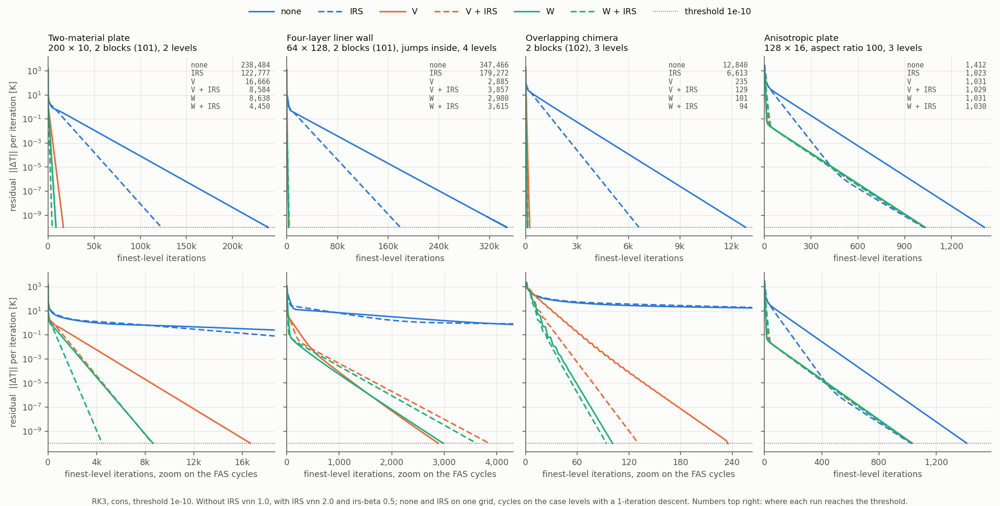
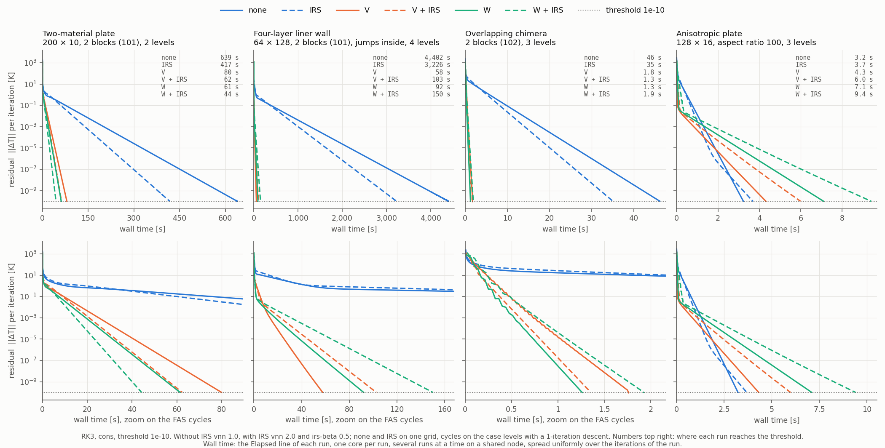

# Multigrid Cycles (FAS) – Measured Performance

The FAS cycles (`cycle = v | w`, [theory](../theory/time-integration.md#fas-cycles)) promise the
same converged field as the baseline run at a fraction of the fine-grid iterations. This page
collects the measured evidence: the six configurations none / IRS / V / W / V + IRS / W + IRS on
four cases of `test/` (two figures), the equivalence checks, the gains on the verification cases,
the stress campaign on representative hard cases, and the known limits. "Iterations" are
finest-level (root-level) iterations as the residual history counts them, the ones the baseline
also counts; with cycles they advance by `pre-iter + post-iter` per cycle and include the
one-iteration descent on each coarse level. Iteration counts are deterministic: every
repetition reproduced them exactly. Wall times come from a shared machine and are only as
reproducible as it is idle: repeated runs differ by up to 1.9×, so read the wall ratios to
within that factor. Each section states its threshold and which timing line it reports.

The four-case campaign and the liner numbers were measured on the current code (series face
conductivity at material jumps inside a block and the face-conductivity time step, both always
on, October 2026). The tables of the earlier FAS review (reference plate to stress campaign)
were measured before those two changes. Blocks of one material are bit-identical under them,
and at a block connection between two materials (the reference plate) only the time step of
the cells on the less conductive side shortens; a material jump inside a block (the bi-material
patch of the nonlinear table, the liner) now carries the series face flux instead, and the
liner, the case the defect had broken, is the one re-measured below.

!!! note "The two invariants behind every number"
    1. **`cycle = none` is the solver without FAS.** When the cycles were introduced this was
       verified on all 17 test cases, serial and 2 MPI ranks, against the pre-FAS binary (commit
       `494ebb1`): 0 bytes differ in any output file. The face-conductivity time step of October
       2026 has since changed, by design, the 7 cases with a block connection between two
       materials (`nominal`, `irs`, `chimera`, `mg1`–`mg3`, `mg_irs`); the 9 one-material cases
       were byte-identical across that change, and `time_convergence/simdir` differs only in its
       `diagnostic.tec`, by round-off in cells still at the initial condition. The `MultigridNoneInert` CTest keeps the guarantee in a
       machine-independent form: every FAS key set under `cycle = none` must reproduce the plain
       run byte for byte.
    2. **Cycles converge to the fine discrete solution.** On patch cases with an exactly
       representable solution the cycle fixed point is bit-exact (residual reaches 0.0); on the
       cases below the field at threshold matches the `none` field to the stopping tolerance.

## Six configurations on four cases

The runner and the plot script live in `test/numerics-features/convergence_figure/`
(`run_configs.sh`, `plot_convergence.py`; the runs take about an hour, two at a time). Four
cases of `test/numerics-features/`, every run RK3, `cons`, `res-threshold = 1e-10`, the residual
written every iteration, one thread:

| Case | Mesh | Levels |
|---|---|---|
| plate (`residual_convergence/fas_v`) | two materials, 2 blocks of 100 × 10 cells joined by a 101 connection | 2 |
| liner (`multimat_liner`) | four-layer liner wall, 64 × 128 cells of 0.31 × 3.9 mm in 2 blocks (101), material jumps inside the blocks (k 5 / 300 / 15 / 150 W/mK), convective walls | 4 |
| chimera (`chimera_mg`) | two overlapping blocks (112 × 16 and 104 × 12 cells, chimera donors on every level) | 3 |
| anisotropic (`anisotropic_Plate`) | 128 × 16 cells of aspect ratio 100, one material | 3 |

`none` and `IRS` run on one grid; the cycles on the case's levels, descending with one
iteration per coarse level and the default `pre-iter = 2`, `post-iter = 1`, `coarse-iter = 10`.
Without IRS `vnn = 1.0`; with IRS `vnn = 2.0` and `irs-beta = 0.5`.

*Residual (‖ΔT‖ per iteration) against finest-level iterations. Colour is the cycle (blue
`none`, orange `v`, green `w`), a dashed line is the same configuration with IRS, the dotted line
is the threshold 1e-10. The top row shows the full range of each case, the bottom row zooms on
the range of the four FAS cycles (the anisotropic plate, where the cycles end with the
single-grid runs, keeps its full range). The numbers at the top right are the iterations at
which each run reaches the threshold.*

*The same histories against wall time: the `Elapsed` line of each run's timing summary
(set-up, iterations and output), spread uniformly over the iterations of the run. One core per
run, two runs at a time on a node shared with other jobs: the times carry that noise, the
iteration counts do not. This campaign ran on a busy node; the same runs on a quieter node
took about half the time (plate `none` 318 s instead of 639 s) with similar ratios.*

Iterations to 1e-10 (wall time, s):

| Configuration | plate | liner | chimera | anisotropic |
|---|---:|---:|---:|---:|
| none | 238 484 (639) | 347 466 (4 402) | 12 840 (46) | 1 412 (3.2) |
| IRS | 122 777 (418) | 179 272 (3 226) | 6 613 (35) | 1 023 (3.7) |
| V | 16 666 (80) | 2 885 (58) | 235 (1.8) | 1 031 (4.3) |
| W | 8 638 (61) | 2 980 (92) | 101 (1.3) | 1 031 (7.1) |
| V + IRS | 8 584 (62) | 3 857 (103) | 129 (1.3) | 1 029 (6.0) |
| **W + IRS** | **4 450 (44)** | **3 615 (150)** | **94 (1.9)** | **1 030 (9.4)** |
| W + IRS vs none, iterations / wall | 54× / 14× | 96× / 29× | 137× / 24× | 1.4× / 0.3× |

What the figures say:

- **Every cycle is one to two orders of magnitude below the single grid** in iterations and
  in time on the three isotropic cases; IRS alone halves the single-grid count.
- **W + IRS needs the fewest iterations on the plate and the chimera case**, where the order
  none > IRS > V > W holds and IRS helps each cycle. **On the liner the four cycles end within
  972 iterations of each other** (2 885 to 3 857) and
  the plain `v` is the one with the fewest: neither W nor IRS buys a lower count on this
  four-level, two-block hierarchy.
- **Wall time follows the iterations only where the cycle is cheap relative to the fine
  smoothing.** A W cycle visits its coarse sub-tree twice and IRS adds two Jacobi sweeps per
  stage, so the cost per fine iteration grows from `v` to `w + IRS`: on the plate (2 levels, a
  cheap coarse grid) and the chimera case the time still falls with the iterations, on the
  liner `v` is the fastest on the clock (58 s against 150 s for
  `w + IRS`, both against 4 402 s for the single grid).
- **On the anisotropic plate nothing pays**: all six runs reach 1e-10 in 1 023–1 412
  iterations and the single-grid run is the cheapest in time ([below](#anisotropic-cells-the-honest-limit)).

## Reference plate (residual_convergence)

The two-material plate of the [residual convergence study](residual-convergence.md) (2 blocks of
100 × 10 cells, 101 connection, `cons`, the case's `vnn = 0.5`), to threshold 1e-8; wall times
are the `Solver` line (without set-up and output), the minimum of three or four runs. The
10-cell height caps the hierarchy at 2 levels, which caps the cycle gain: this is the *worst*
verified configuration, and the one the `fas_v` / `fas_w` / `fas_w_irs` test cases ship.

| Configuration | Fine iterations | Wall (s) | Iterations vs `nominal` | Wall vs `nominal` |
|---|---:|---:|---:|---:|
| nominal (single grid) | 369 090 | 473 | 1× | 1× |
| irs | 99 305 | 236 | 3.7× | 2.0× |
| mg3 (sequencing) | 144 108 | 121 | 2.6× | 3.9× |
| mg + irs | 80 603 | 126 | 4.6× | 3.8× |
| **cycle = v** | 25 756 | 63 | 14× | 7.5× |
| **cycle = w** | 13 345 | 53 | 28× | 9.0× |
| **cycle = v + irs** | 6 934 | 25 | 53× | 19× |
| **cycle = w + irs** | **3 593** | **19** | **103×** | **24×** |
| cycle = v, coarse-iter 50 | 5 458 | 57 | 68× | 8.3× |
| cycle = v, coarse-iter 1 | 158 191 | — | 2.3× | (cripples the cycle) |

The cycle rows use the defaults (`coarse-iter = 10`, `pre-iter = 2`, `post-iter = 1`). On a
2-level hierarchy the coarse solve is the knob: `w + irs` needs 15 686 / 8 518 / 3 593 iterations
with `coarse-iter` 2 / 4 / 10, and on two levels `w` is exactly `v` with twice the coarse
iterations (`w` with `coarse-iter = 2` reproduces `v` with 4 bit for bit). The wall gains are
smaller than the iteration gains because every cycle adds its coarse work and transfers to the
fine smoothing. With deep hierarchies (below) the default is already optimal and W becomes
insensitive to it.

## Grid independence (deep hierarchies)

Unit-square patch case, full hierarchies, `coarse-iter 10`. Root iterations to 1e-12 (wall):

| Fine mesh | none | w | w + irs |
|---|---:|---:|---:|
| 32² (3 levels) | 12 854 (9.8 s) | 184 (0.5 s) | 103 (0.3 s) |
| 64² (4 levels) | 49 077 (184 s) | 191 (1.1 s) | 107 (1.0 s) |
| 128² (5 levels) | ~201 700 (~3 600 s), extrapolated | 207 (5.3 s) | 111 (4.2 s) |

The W-cycle iteration count is essentially **independent of N** (textbook behaviour): ~1800× fewer
iterations at 128² and, against the extrapolated single-grid run (10 000 iterations timed,
17.9 ms each), ~700× (`w`) to ~850× (`w + irs`) less wall time. Rates per cycle 0.37–0.41 for
`w + irs`.

## Nonlinear, layered, 3D

| Case | none | cycle | Gain (iterations / wall) |
|---|---:|---:|---:|
| k(T)×3, cp(T)×2 nonlinear (64², 3 levels, 1e-10) | 43 353 (167 s) | w: 211 (1.4 s) | 205× / ~120× |
| Bi-material k×10, interface on all levels (64², 3 levels, 1e-11) | 44 955 (114 s) | w: 217 (1.3 s) | 207× / ~90× |
| 3D box 16³ (2 levels, 1e-12) | 2 983 (7.7 s) | v: 263 (1.0 s), w: 185 (0.9 s) | 11–16× / 8–9× |

Fields equal to the `none` fields within 3e-9 K at threshold.

## Chimera (overset blocks)

Verification case `numerics-features/chimera_mg`: two genuinely overlapping blocks
(112 × 16 and 104 × 12 cells, 0.09 m overlap, different spacing in both directions), chimera
donors on all 3 levels built by ATLAS BCB (`BC-chimera = true`, `MG-levels = 3`; the files
of ATLAS main `7d35c3a`, whose sampled overlap weights close every receiver to 1). The FAS
transfers never read a chimera receiver: restriction, forcing and correction sums run over
interior cells only, the receivers are ghost cells refreshed by each level's own chimera fill,
and (with IRS) the ghost residual at a 102 face is already zero-gradient — the same policy IRS
applies to every non-connection ghost. Threshold 1e-8 at the case's `vnn = 0.5`
(the [campaign above](#six-configurations-on-four-cases) runs it at 1e-10 and `vnn = 1.0`):

| Check | Result |
|---|---|
| `cycle = none` vs pre-FAS binary, serial and 2 ranks | bit-identical (0 bytes differ) |
| `v` / `w`: 1 process vs 2 ranks (one block per rank, donors cross ranks on all levels) | bit-identical |
| Field vs `none` at 1e-8 | v: 3.0e-7 K, w: 3.0e-7 K |
| Admissibility fallbacks (`FAS:` reports) | none |
| Iterations (wall): none 13 367 (37 s) | v 2 613 (7.3 s; 5.1× / 5.1×), **w 1 700 (2.7 s; 7.9× / 14×)** (iterations / wall, busy node) |

**W is safe with chimera.** The study provisioned a V-only constraint near 102 boundaries
(CFL3D practice); the data shows W converging faster than V, bit-reproducibly across ranks and
with zero admissibility fallbacks, so no constraint is imposed.

## Stress campaign

Four hard configurations built for the FAS review (generators in the verification tooling), all
run to 1e-8 with `coarse-iter 10` and immediate descent; fields checked against the `none`
field (≤ 5e-7 K) or, for the 3D patch cases, against the exact linear solution (≤ 2e-9 K).

| Case | none | v | w | w + irs | w + irs gain (iterations / wall) |
|---|---:|---:|---:|---:|---:|
| 4 conformal blocks, 101 connections (2×2 × 32², 3 levels) | 14 047 (66 s) | 261 | 96 | **57** (1.0 s) | 246× / 66× |
| Localized q̇ hot spot (64², discontinuous source, 3 levels) | 34 637 (102 s) | 610 | 169 | **49** (0.8 s) | 707× / ~130× |
| 3D box 32³ (3 levels) | 8 493 (323 s) | 1 324 | 135 | **66** (5.3 s) | 129× / 61× |
| 3D box 64³ (4 levels) | ~33 000 extrap. (~2.7 h)¹ | — | 139 (39 s) | **69** (42 s) | ~480× / ~230× |

¹ The 64³ baseline was stopped at 10 000 iterations (residual 1.3e-2, rate 0.9994/iter); its
wall time is extrapolated from 1 500 timed iterations (0.29 s each). The cycles reach the
*exact* discrete solution (max error ≤ 8e-10 K) in ~100 iterations: the W-cycle
iteration count barely moves from 32³ to 64³ (135 → 139, 66 → 69), the same N-independence
measured in 2D.

### The liner: a face defect, not a cycle defect

**Realistic liner (4 material layers, squeezed cells, hard BCs).** 64 × 128 cells, 0.3 × 3.9 mm
(aspect ratio 12.5), layers coat / liner / jacket / shell with k = 5 / 300 / 15 / 150 W/mK on
all-level grid lines, convective 303 walls (hot side Tref 3000 → 1500 K along the wall, cold
side h = 10⁴). The campaign version was one block; `test/numerics-features/multimat_liner` is
the same wall split along its length into two 64 × 64 blocks joined by a 101 connection, with
the material jumps inside both blocks (so 2 ranks each own a block).

On the code of the FAS review this case was the one that would not behave: the explicit
baseline died at the liner → jacket interface within a few steps at `vnn = 0.5` (T < 0 K),
plain IRS at `vnn = 2.0` or `1.0` locked into a bounded residual orbit with its admissibility
fallback firing on ~4·10⁵ cell updates per report, the cycles inherited the orbit whenever IRS
was on, and only `v` / `w` without IRS at `vnn = 0.2` converged (8 362 and 7 222 iterations,
against 1 259 270 for the baseline). **Both symptoms were one defect in the face flux, not in
the cycles.** An interior face took the conductivity of the lower-index cell's material: at the
300 → 15 jump the first jacket cell exchanged heat through 20 times its own k (the face flux
carried the copper-side transmissibility, 10.5 times the series value of the two half cells)
while its time step was built on k = 15, so every explicit update at that face violated the
stability bound — a crash without IRS, the admissibility orbit with it (the fallback was the
symptom). The steady field was wrong too: against a reference with each layer in its own block,
where the 101 connections always balanced the two half cells in series, the single-block
solution was off by 35.7 K.

The resolution is in the discretisation and needs no key: a face between two materials inside a
block carries the series conductivity of its two half cells, k = (h₁ + h₂) / (h₁/k₁ + h₂/k₂)
([Face Conductivity](../theory/numerics.md#face-conductivity)), and the local time step takes
the severest face conductivity of each direction, evaluated as the flux evaluates it
([VNN](../theory/time-integration.md#diffusive-stability-condition-vnn)); both are always on,
and blocks of one material keep their step bit for bit. Measured on the one-block liner at 1e-8
(RK3, `cons`, 4 levels with a one-iteration descent, `cycle = none` for the rows without a
cycle; wall times the `Elapsed` line):

| Configuration | Result |
|---|---|
| Field vs the per-layer-block reference | 1.2e-8 K (was 35.7 K) |
| none, `vnn = 1.2` | converges: 231 890 iterations, 1 596 s |
| none, ceiling | `vnn = 1.25` stable (20 000 iterations), `vnn = 1.3` fails at iteration 91 (T = −43 K, outside the properties table): the RK3 limit is 1.25 ([VNN](../theory/time-integration.md#diffusive-stability-condition-vnn)) |
| IRS, `vnn = 2.0` | descends cleanly, no halved update, but slowly: 2.4e-6 after 100 000 iterations (1 009 s) |
| w, `vnn = 1.0` / `1.2` | 1 697 iterations (30 s) / 1 438 (26 s) |
| w + IRS, `vnn = 1.0` | 2 842 iterations (67 s), **zero** halved updates |
| series faces with the old cell time step, `vnn` 0.5 / 1.0 / 1.2 | stable over 3 000 iterations (residual 2.3 / 1.4 / 1.1, still descending): the face flux was the defect, the face step is what lets the run go at `vnn ≥ 1` |

The two-block `multimat_liner` converges in all six configurations on the current code
([campaign table](#six-configurations-on-four-cases): to 1e-10 none 347 466
iterations, IRS 179 272, the cycles 2 885 to 3 857, every run
without a single halved update). The liner is now a normal case, and the robustness ranking
the review had measured on it — cycles first, IRS last — was an artefact of the face flux.

## Anisotropic cells: the honest limit

Reference case `numerics-features/anisotropic_Plate` (128 × 16 cells on 1 m × 1.25 mm: cell
aspect ratio 100, 3 levels, exact linear solution), the campaign settings above (RK3, `cons`,
residual every iteration; the shipped case writes it every 100 and runs `w` + IRS):

| Configuration | Iterations to 1e-10 | Wall (s) | Residual floor at 1e-13 (iterations run) |
|---|---:|---:|---:|
| none | 1 412 | 3.2 | 7.9e-13 (400 000) |
| IRS | 1 023 | 3.7 | 2.2e-12 (400 000) |
| v | 1 031 | 4.3 | 4.5e-12 (100 000) |
| w | 1 031 | 7.1 | 4.3e-12 (100 000) |
| v + IRS | 1 029 | 6.0 | 9.8e-13 (100 000) |
| w + IRS | 1 030 | 9.4 | 1.0e-12 (100 000) |

V and W need the same iterations and IRS does not change the count either: the coarse
correction, not the cycle shape, is the bottleneck. Full coarsening with a pointwise explicit
smoother cannot represent the strong transverse coupling on the coarse levels. **In wall time
the cycles cost more than the single grid here.** The threshold is reached early on this case
for a reason that has nothing to do with the solvers: the time step of an aspect-ratio-100 cell
is tiny, so the residual ‖ΔT‖ per iteration is small long before the field has converged, and at
1e-13 every configuration sits on a round-off floor of ~1e-12 (last column; all cross 1e-11
between 1 157 and 1 545 iterations and none reaches 1e-13 within its budget). On AR ≫ 1 meshes
run the single grid or IRS; the cure (line-implicit smoothing or semi-coarsening) is outside the
FAS v1 perimeter.

## Deep V instability

`cycle = v` without IRS on 4 or more levels can lock into a bounded limit cycle (residual
oscillating at a large value, a steady stream of `FAS: ... updates halved` reports). This is a
property of the method (weak explicit smoothing vs accumulated coarse corrections), not of a
case: use `w`, or enable IRS. Documented in
[time integration](../theory/time-integration.md#fas-cycles). The four-level liner above runs
`v` without IRS to 1e-10 in 2 885 iterations without a halved update: the instability
is possible, not certain.

## Practical guidance

- **Recommended: `cycle = w` with IRS (`irs-beta = 0.5`, `vnn = 2.0`)**: the fewest iterations
  on the plate, the chimera case and every patch case of the review, textbook N-independent
  rates, insensitive to `coarse-iter` on deep hierarchies, safe with chimera and at any depth,
  and the configuration that stays stable where the others can fail (`v` on 4+ levels, the
  explicit single grid at the VNN ceiling). The default `cycle = none` is the bit-identical
  pre-FAS run, kept for that reason.
- **Wall time is not iterations.** `w` + IRS costs more per fine iteration than `v` or `w`
  alone; where the cycles converge within a few hundred iterations of each other the cheapest
  cycle per iteration wins the clock, and on the two-block liner plain `v` even needs the
  fewest iterations (`v` 58 s, `w` + IRS 150 s, both against
  4 402 s for the single grid). For a case that will be run many times, measure the
  candidates on it.
- **Strongly anisotropic cells (AR ≫ 1):** the cycles do not pay; the single grid or IRS alone
  is as fast ([above](#anisotropic-cells-the-honest-limit)).
- Multimaterial meshes with large conductivity jumps inside a block are ordinary cases: the
  series face conductivity and the face-conductivity time step are always on, no key to set;
  the liner runs every configuration at `vnn = 1.0` (`2.0` with IRS).
- `coarse-iter = 10` (the default) is right for deep hierarchies; raise it only on 2-level
  hierarchies where the coarsest solve is the bottleneck.
- `v` without IRS: 3 levels at most, unless measured on the case.
- Descend immediately (`level<m>-iter = 1` for m > 1): cycling from the start beats long
  sequencing stints. With `levels > 1` the stop is `level1-iter` or `res-threshold`:
  `iter-threshold` is ignored, with a warning at set-up.
