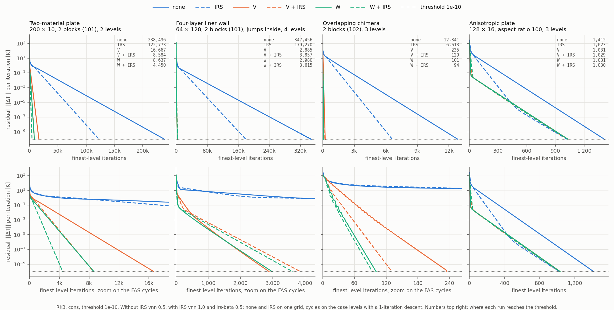
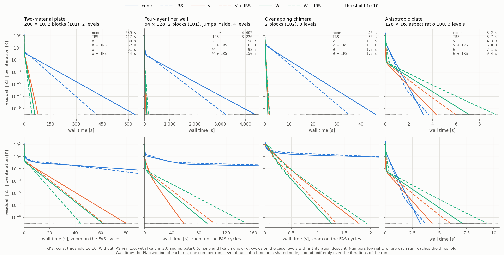

# Multigrid Cycles (FAS)

 Multigrid cycles promise the same converged field with much less computational time. The method is described in
[Time Integration](../theory/time-integration.md#fas-cycles).

How to read the numbers:

- **Iterations** are fine-level iterations, as the residual history counts them. Under a cycle they
  advance by `pre-iter + post-iter` per cycle. They are deterministic: every repetition gives the
  same count.
- **Wall times** come from one core per run on a shared, loaded node. Repeated runs differ by up to
  1.9×. Compare them within one table, not across machines.
- Every run stops when its residual has fallen by the stated factor from its first value on the
  finest level.

---

## Two guarantees

1. **`cycle = none` is the solver without FAS.** Every FAS key set under `cycle = none` reproduces
   the plain run byte for byte (CTest `MultigridNoneInert`).
2. **The cycles converge to the fine-grid solution.** The coarse forcing absorbs any inconsistency of
   the coarse operators. On a patch case with an exactly representable solution the cycle reaches
   it bit for bit (residual 0.0); elsewhere the field matches the `none` field to the stopping
   tolerance.

---

## Six configurations on four cases

Four cases of `test/numerics-features/`:

| Case | Mesh | Levels |
|---|---|---|
| plate | two materials, 2 blocks of 100 × 10 cells joined by a connection | 2 |
| liner | four-layer wall, 64 × 128 cells of 0.31 × 3.9 mm in 2 blocks, material jumps inside the blocks (k = 5 / 300 / 15 / 150 W/mK), convective walls | 4 |
| chimera | two overlapping blocks (112 × 16 and 104 × 12 cells), chimera donors on every level | 3 |
| anisotropic | 128 × 16 cells of aspect ratio 100, one material | 3 |

All runs use RK3 and `cons`, stop at a fall of 10⁻¹⁰, and descend at once (one iteration per coarse
level). Without IRS `vnn = 0.5`; with IRS `vnn = 1.0`, `irs-beta = 0.5`. The cycles use the default
`pre-iter = 2`, `post-iter = 1`, `coarse-iter = 10`.

*Residual against fine-level iterations. Colour is the cycle (blue `none`, orange `v`, green `w`);
dashed lines add IRS. Top row: full range; bottom row: the range of the four cycles. The numbers at
top right are the iterations at which each run ends.*

*The same histories against wall time (set-up, iterations and output, spread uniformly over the
iterations). The times carry the noise of a loaded node; the iteration counts do not.*

Iterations to a fall of 10⁻¹⁰ (wall time in s):

| Configuration | plate | liner | chimera | anisotropic |
|---|---:|---:|---:|---:|
| none | 166 578 (184) | 244 325 (1 266) | 9 209 (12.8) | 1 022 (1.0) |
| IRS | 84 215 (142) | 123 712 (995) | 4 679 (11.9) | 565 (1.0) |
| V | 12 264 (27) | 2 020 (17.8) | 178 (0.6) | 749 (1.3) |
| W | 6 355 (20) | 2 061 (28.7) | 77 (0.6) | 749 (2.3) |
| V + IRS | 6 656 (21) | 2 704 (34.2) | 99 (0.6) | 680 (2.1) |
| **W + IRS** | **3 449 (17)** | **2 521 (49.5)** | **71 (0.6)** | **682 (3.1)** |
| W + IRS against none, iterations / wall | 48× / 11× | 97× / 26× | 130× / 21× | 1.5× / 0.3× |

- **Every cycle beats the single grid by 14× to 130× in iterations** and 7× to 71× in time on the
  three isotropic cases. IRS alone halves the single-grid count.
- **W + IRS needs the fewest iterations on the plate and the chimera case.** There the order
  none > IRS > V > W holds, and IRS helps every cycle.
- **On the liner the four cycles end within 700 iterations of each other**, and plain V needs the
  fewest. Neither W nor IRS lowers the count on this four-level, two-block hierarchy.
- **Wall time follows iterations only where a cycle is cheap.** W visits its coarse levels twice,
  and IRS adds two Jacobi sweeps per stage. On the liner V is fastest on the clock: 17.8 s against
  49.5 s for W + IRS and 1 266 s for the single grid.
- **On the anisotropic plate nothing pays** ([below](#anisotropic-cells)).

---

## Two-level plate: the coarse solve is the knob

The plate of the [residual convergence study](residual-convergence.md) at its own `vnn = 0.25`,
stopped at a fall of 10⁻⁸. Wall times are the solver time without set-up and output. Its 10-cell
height caps the hierarchy at two levels, which caps the gain: this is the least favourable case for
the cycles.

| Configuration | Fine iterations | Wall (s) | Iterations vs nominal | Wall vs nominal |
|---|---:|---:|---:|---:|
| nominal (single grid) | 236 927 | 226 | 1× | 1× |
| IRS | 60 855 | 96 | 3.9× | 2.4× |
| grid sequencing (mg3) | 163 642 | 110 | 1.4× | 2.1× |
| grid sequencing + IRS | 55 523 | 68 | 4.3× | 3.3× |
| **V** | 17 155 | 36 | 14× | 6.3× |
| **W** | 8 890 | 27 | 27× | 8.3× |
| **V + IRS** | 5 023 | 16 | 47× | 14× |
| **W + IRS** | **2 605** | **13** | **91×** | **18×** |
| V, `coarse-iter = 50` | 3 637 | 21 | 65× | 11× |
| V, `coarse-iter = 1` | 105 296 | 124 | 2.3× | 1.8× |

The grid-sequencing rows stop from a first fine-level residual about 60 times smaller, so they end
deeper ([Residual Convergence](residual-convergence.md)).

On two levels the coarse solve decides the rate:

- W + IRS needs 11 365, 6 172 and 2 605 iterations with `coarse-iter` 2, 4 and 10.
- On two levels W is exactly V with twice the coarse iterations: W with `coarse-iter = 2` reproduces
  V with 4 bit for bit.
- One coarse iteration cripples the cycle.

The wall gains are smaller than the iteration gains because every cycle adds its coarse work and
transfers. On deep hierarchies (below) the default `coarse-iter = 10` is already optimal.

---

## Grid independence

Unit-square patch case, full hierarchies, `coarse-iter = 10`, a fall of 10⁻¹²:

| Fine mesh | none | W | W + IRS |
|---|---:|---:|---:|
| 32² (3 levels) | 10 627 (5.4 s) | 145 (0.19 s) | 81 (0.17 s) |
| 64² (4 levels) | 41 044 (85 s) | 148 (0.71 s) | 77 (0.57 s) |
| 128² (5 levels) | 158 048 (1 395 s) | 152 (2.8 s) | 77 (2.3 s) |

**The W-cycle count does not grow with the mesh**, the textbook behaviour. At 128² W needs about
1 000× fewer iterations than the single grid and W + IRS about 2 000×; wall time falls 500× to 600×.
W + IRS reduces the residual by 0.34–0.36 per cycle.

---

## Nonlinear, layered and 3-D cases

| Case | none | cycle | Gain (iterations / wall) |
|---|---:|---:|---:|
| k(T) × 3, cp(T) × 2 (64², 3 levels, fall of 10⁻¹⁰) | 32 236 (78 s) | W: 160 (0.90 s) | 201× / 87× |
| Two materials, k × 10, interface on all levels (64², 3 levels, 10⁻¹¹) | 35 118 (83 s) | W: 172 (1.07 s) | 204× / 78× |
| 3-D box 16³ (2 levels, 10⁻¹²) | 2 441 (5.5 s) | V: 200 (0.74 s), W: 143 (0.69 s) | 12–17× / 7.5–8.0× |

At the threshold the fields equal the `none` fields within 1.3 × 10⁻⁶, 7.9 × 10⁻⁸ and
3.1 × 10⁻⁹ K.

---

## Hard cases

Four configurations built to stress the cycles, all stopped at a fall of 10⁻⁸ with
`coarse-iter = 10` and an immediate descent. Every field is within 1.5 × 10⁻⁴ K of the `none` field.

| Case | none | V | W | W + IRS | W + IRS gain (iterations / wall) |
|---|---:|---:|---:|---:|---:|
| 4 blocks joined by connections (2 × 2 × 32², 3 levels) | 9 681 (20 s) | 183 | 69 | **41** (0.36 s) | 236× / 57× |
| Localised, discontinuous heat source (64², 3 levels) | 28 736 (58 s) | 507 | 142 | **40** (0.30 s) | 718× / 189× |
| 3-D box 32³ (3 levels) | 5 580 (108 s) | 931 | 94 | **47** (2.0 s) | 119× / 53× |
| 3-D box 64³ (4 levels) | not run | — | 95 (21 s) | **48** (15 s) | — |

The W-cycle count barely moves from 32³ to 64³ (94 → 95, 47 → 48): the same mesh independence as in
2-D.

---

## Chimera (overset blocks)

The `chimera_mg` case: two overlapping blocks (112 × 16 and 104 × 12 cells, 0.09 m overlap,
different spacing in both directions), with chimera donors on all three levels. Stopped at a fall of
10⁻⁸ at the case's `vnn = 0.25`.

| Check | Result |
|---|---|
| V and W: 1 process against 2 ranks (one block per rank, donors across ranks on every level) | bit-identical |
| Field against `none` | V: 4.0 × 10⁻⁵ K, W: 4.1 × 10⁻⁵ K |
| Halved or dropped updates (`FAS:` reports) | none |
| Iterations (wall) | none 9 153 (10.5 s); V 1 914 (2.0 s); **W 1 241 (0.74 s)** |

**W is safe with chimera.** It converges faster than V, bit-reproducibly across ranks, with no
halved update. The FAS transfers never read a chimera receiver (see
[Time Integration](../theory/time-integration.md#fas-cycles)).

---

## Material jumps inside a block

**The four-layer liner converges in every configuration.** The liner has material jumps inside its
blocks, from k = 300 to 15 W/(m·K), on cells of aspect ratio 12.5, with hard convective walls (hot
side Tref 3000 → 1500 K along the wall, cold side h = 10⁴ W/(m²·K)).

Two parts of the discretisation make this an ordinary case, with no key to set:

- a face between two materials carries the series conductivity of its two half cells,
  $k = (h_1 + h_2)/(h_1/k_1 + h_2/k_2)$ ([Face Conductivity](../theory/numerics.md#face-conductivity));
- the local time step takes the largest face conductivity in each direction
  ([VNN](../theory/time-integration.md#diffusive-stability-condition-vnn)).

Measured on the one-block liner (RK3, `cons`, 4 levels, a fall of 10⁻⁸):

| Configuration | Result |
|---|---|
| Field against a reference with one block per layer | 1.2 × 10⁻⁸ K |
| none, `vnn = 0.6` | converges: 153 677 iterations, 807 s |
| none, stability limit | `vnn = 0.625` stable, `0.65` fails at iteration 91: the RK3 limit is 0.628 |
| IRS, `vnn = 1.0` | converges, slowly: 94 682 iterations, 774 s |
| W, `vnn = 0.5` / `0.6` | 808 iterations (12 s) / 684 (9.8 s) |
| W + IRS, `vnn = 0.5` | 1 267 iterations (25 s), no halved update |

The two-block `multimat_liner` case converges in all six configurations of the
[first table](#six-configurations-on-four-cases), without a single halved update.

---

## Anisotropic cells

**On cells of aspect ratio 100 the cycles cost more than the single grid.** The case is
`anisotropic_Plate`: 128 × 16 cells on 1 m × 1.25 mm, 3 levels, an exact linear solution.

| Configuration | Iterations (fall of 10⁻¹⁰) | Wall (s) | Lowest residual (iterations run) |
|---|---:|---:|---:|
| none | 1 022 | 1.0 | 7.9 × 10⁻¹³ (400 000) |
| IRS | 565 | 1.0 | 3.5 × 10⁻¹² (400 000) |
| V | 749 | 1.3 | 3.9 × 10⁻¹² (100 000) |
| W | 749 | 2.3 | 3.9 × 10⁻¹² (100 000) |
| V + IRS | 680 | 2.1 | 8.0 × 10⁻¹³ (100 000) |
| W + IRS | 682 | 3.1 | 1.1 × 10⁻¹² (100 000) |

The last column is the round-off floor, reached by continuing each run for the iterations shown.

- **V and W need the same iterations, and IRS alone needs the fewest.** The bottleneck is the coarse
  correction, not the cycle shape: full coarsening with a pointwise explicit smoother cannot carry
  the strong coupling across the thin direction.
- **The threshold is reached early for a reason unrelated to the solver.** The time step of such a
  thin cell is tiny, so the temperature change per iteration is small long before the field has
  converged.

On meshes with aspect ratios far above 1, use the single grid or IRS alone. Line-implicit smoothing
or semi-coarsening, which would fix this, is not available.

---

## Deep V without IRS

**V without IRS on four or more levels can stall.** The residual then oscillates at a large value
and the log fills with `FAS: ... updates halved` reports. This is a property of the method, not of a
case: the explicit smoothing is too weak for the accumulated coarse corrections. Use W, or enable
IRS. The four-level liner runs V without IRS to convergence: the stall is possible, not certain.

---

## Reproducibility

- **Ranks and threads.** Under cycles, 1×4, 2×1, 2×4, 4×1 and 4×4 (ranks × threads) write the files
  of 1×1, bit for bit, on five cases (`fas_w_irs`, chimera W, the liner W + IRS, the 128² plate
  W + IRS, the 16³ box W): 25 of 25 layouts.
- **Restart.** A V run stopped and restarted reproduces the uninterrupted field to the last bit.

---

## Practical guidance

- **Default choice: `cycle = w` with IRS** (`irs-beta = 0.5`, `vnn = 1.0`). It needs the fewest
  iterations on the plate, the chimera case and every patch case, converges at a rate independent of
  the mesh, ignores `coarse-iter` on deep hierarchies, and is safe with chimera at any depth.
- **Wall time is not iterations.** W + IRS costs more per fine iteration than V or W alone. Where
  the cycles end within a few hundred iterations of each other, the cheapest cycle wins the clock.
  For a case that runs many times, time the candidates on it.
- **Strongly anisotropic cells:** the cycles do not pay; use the single grid or IRS alone.
- **Material jumps inside a block** need no special setting: the liner runs every configuration at
  `vnn = 0.5` (1.0 with IRS).
- **`coarse-iter = 10`** (the default) suits deep hierarchies. Raise it only on two-level
  hierarchies.
- **V without IRS:** at most three levels, unless tested on the case.
- **Descend at once** (`level<m>-iter = 1` for m > 1): cycling from the start beats long sequencing
  stints. With `levels > 1` the run stops on `level1-iter` or `res-threshold`; `iter-threshold` is
  ignored, with a warning at set-up.

To reproduce the two figures, see `test/numerics-features/convergence_figure/README.md`.
