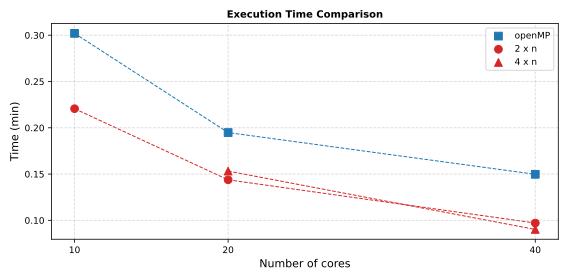

# Parallel Scaling

Wall-clock time of the same 1000-iteration run under eight parallel configurations: three with OpenMP threads only, five with MPI ranks × OpenMP threads. The case is `test/numerics-features/time_convergence/simdir`; its logs are kept in `SOLUTION/`.

---

## Case

A plate of 4.0 m × 0.2 m (0.01 m thick) split into four blocks of 1000 × 20 cells along x, 80 000 cells in total, joined by block connections (BC 101).

| Blocks | x (m) | Material | k (W/mK) | ρ (kg/m³) | c<sub>p</sub> (J/kgK) |
|---|---|---|---|---|---|
| 1, 2 | 0 – 2 | mat1 | 10 | 8000 | 450 |
| 3, 4 | 2 – 4 | mat2 | 100 | 8000 | 450 |

| Face | Condition |
|---|---|
| Block 1, face 1 (x = 0) | T = 1000 K (302) |
| Block 4, face 2 (x = 4 m) | T = 2000 K (302) |
| Faces 3–6 | `null` (adiabatic) |

Initial temperature 1500 K. Numerics: RK3, VNN 1.5, local time step, primitive variables, IRS with β = 0.5, `iter-threshold = 1000`. The run stops long before steady state (the residual drops from 3.9 × 10³ to 5.6): only the time per iteration matters here.

## Configurations and results



| Case | MPI ranks × threads | Cores | Time (min) |
|---|---|---|---|
| openMP-10 | 1 × 10 | 10 | 0.302 |
| MPI-2x5 | 2 × 5 | 10 | 0.221 |
| openMP-20 | 1 × 20 | 20 | 0.195 |
| MPI-4x5 | 4 × 5 | 20 | 0.153 |
| MPI-2x10 | 2 × 10 | 20 | 0.144 |
| openMP-40 | 1 × 40 | 40 | 0.150 |
| MPI-2x20 | 2 × 20 | 40 | 0.097 |
| MPI-4x10 | 4 × 10 | 40 | 0.090 |

- At equal core count the MPI runs are faster: at 40 cores, MPI-4x10 takes 0.090 min against 0.150 min with 40 threads.
- Threads alone scale by 2.0× from 10 to 40 cores (0.302 → 0.150 min); the 2-rank series by 2.3× (0.221 → 0.097 min).
- With 4 blocks, 4 ranks hold one block each and 2 ranks two blocks each: both partitions are balanced. More ranks than blocks leave ranks idle (see [Parallel Execution](../user/parallel.md)).

The logs come from the initial public release; the absolute times depend on the machine, which the logs do not record.

## Reproducing

```bash
cd test/numerics-features/time_convergence/simdir
./FUSS.sh -p 10 solve > ../SOLUTION/openMP-10      # 1 x 10
./FUSS.sh -m 2 -p 5 solve > ../SOLUTION/MPI-2x5     # 2 x 5
cd .. && python3 plot.py                            # time_convergence.svg
```

`plot.py` reads the total time from each log in `SOLUTION/` (the `Time of operation` line of older logs, or `Elapsed` of the current timing summary) and draws the figure.
