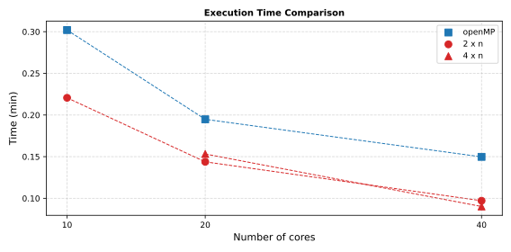

# Parallel Scaling

**At equal core count, MPI ranks with threads beat threads alone: at 40 cores, 4 ranks × 10 threads
take 40 % less time than 40 threads.** This study times one 1000-iteration run in eight parallel
layouts.

Setup and run: `test/numerics-features/time_convergence/README.md`.

---

## Case

A plate of 4.0 m × 0.2 m in four blocks of 1000 × 20 cells along x (80 000 cells), joined by block
connections. Blocks 1–2 have k = 10 W/(m·K), blocks 3–4 k = 100 W/(m·K). The ends are held at
1000 K and 2000 K. The run stops after 1000 iterations, long before steady state: only the time per
iteration matters.

## Result

| Case | Ranks × threads | Cores | Time (min) |
|---|---|---|---|
| openMP-10 | 1 × 10 | 10 | 0.302 |
| MPI-2x5 | 2 × 5 | 10 | 0.221 |
| openMP-20 | 1 × 20 | 20 | 0.195 |
| MPI-4x5 | 4 × 5 | 20 | 0.153 |
| MPI-2x10 | 2 × 10 | 20 | 0.144 |
| openMP-40 | 1 × 40 | 40 | 0.150 |
| MPI-2x20 | 2 × 20 | 40 | 0.097 |
| MPI-4x10 | 4 × 10 | 40 | 0.090 |

- **MPI wins at every core count.** At 40 cores, 4 × 10 takes 0.090 min against 0.150 min with 40
  threads.
- **Threads alone scale by 2.0× from 10 to 40 cores**; the 2-rank series by 2.3×.
- **Both partitions are balanced**: 4 ranks hold one block each, 2 ranks two blocks each. With more
  ranks than blocks some ranks idle (see [Parallel Execution](../user/parallel.md)).

The machine of these runs is not recorded: compare the layouts with each other, not the absolute
times with another machine.
