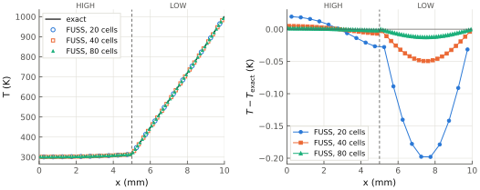
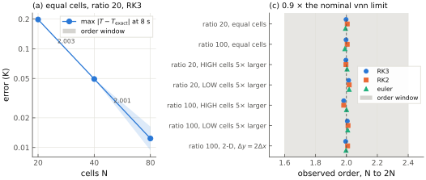

# Two Materials in One Block under Pyrolysis

The test checks the face between two materials inside a block on the pyrolysis path: its conductivity, the
two half cells in series ([Effective Properties](../theory/pyrolysis.md#effective-properties)), and the time step
beside it, the plain cell step ([Time Integration](../theory/time-integration.md)).

Setup and run: `test/pyrolysis/two_layer/README.md`. Gate: `Gate_PyrolysisTwoLayer`
(`run_physics_gates.sh -c pyrolysis_two_layer`).

---

## Problem

A slab of two materials in one block, no kinetics and constant properties, so the energy equation is the heat
equation of a composite slab:

| | material 1 `HIGH` ($0 < x < A$) | material 2 `LOW` ($A < x < L$) |
|---|---|---|
| $k_s$ (W/mK) | 8.0 | 0.4 |
| $\rho_s$ (kg/m³) | 2800 | 280 |
| $c_{p,s}$ (J/kgK) | 4000 | 1000 |

$L = 10$ mm, $A = L/2$ on a cell face. Face 1 ($x = 0$) is adiabatic (301), face 2 ($x = L$) is held at
1000 K from $t = 0$ (302), $T(x, 0) = 300$ K, gas closure type 1. The conductivity ratio is 20; the variants
with ratio 100 keep $\alpha_\text{HIGH} = \alpha_\text{LOW}/2$ ($k = 0.4R$, $\rho_s = 140R$).

**Exact reference.** The eigenfunction series of the step-heated, back-insulated composite slab
(`test/pyrolysis/tools/two_layer_exact.py`): $T = T_W + (T_0 - T_W)\sum_n c_n X_n(x)\,e^{-\lambda_n^2 t}$ with
$X_n = \cos(\lambda_n x/\sqrt{\alpha_1})$ in layer 1 and a sine in layer 2, $T$ and $k\,\partial T/\partial x$
continuous at $A$; the roots are refined by bisection to the last bit. With two equal layers it reproduces the
one-material series to round-off. The error is the maximum of $|T - T_\text{exact}|$ over the cell centres.

## Pass criteria

- **(a) Order.** $k$ ratio 20, $N = 20, 40, 80$ equal cells, RK3 at `vnn = 0.05`, the output nearest 8 s:
  the error falls on every rung and its observed order on the finest pair lies in $[1.6, 2.4]$ (the
  convergence rule with $p = 2$, [Testing](../development/testing.md#the-physics-gate-convention-testpyrolysis)).
- **(b) Stability at the nominal limits.** Seven meshes — $k$ ratio 20 and 100 on equal cells (40), cells
  five times larger in `HIGH` (8 + 40 cells) and in `LOW` (40 + 8) for both ratios, and ratio 100 on 40 × 4
  cells with $\Delta y = 2\Delta x$ — at `vnn` 0.628 (RK3), 0.5 (RK2), 0.5 (euler), outputs every second:
  the run reaches 8 s and its error at the last output is below that at the first. At the nominal limit the
  shortest mode of the scheme is not damped, for one material as for two, so these runs are graded on
  stability only.
- **(c) Order below the limits.** The same seven meshes at 0.9 × the limits (0.5652, 0.45, 0.45), on $N$
  and $2N$ cells (the 2-D mesh refined in both directions): the error falls and the order lies in
  $[1.6, 2.4]$.
- **(d) Block independence.** Type 2, $N = 40$: the slab as one block and cut at the interface into two
  blocks (the jump becomes a block connection, 101) take the same steps and agree on $T$ within
  $10^{-10}$ K and on $p_{pg}$ within $5\times10^{-8}$ Pa. These two bounds are floors set from measured
  draws (five times the widest of eleven draws), not a physics budget.

## Result

**(a)** errors at 8 s:

| $N$ | max $\lvert T - T_\text{exact}\rvert$ (K) | order |
|---|---|---|
| 20 | 1.980 × 10⁻¹ | |
| 40 | 4.939 × 10⁻² | 2.003 |
| 80 | 1.234 × 10⁻² | 2.001 |

With the arithmetic mean of the two $k_s$ at the jump instead of the series value, the same ladder falls at
first order: 27.1, 13.6, 6.83 K (orders 0.992, 0.996).

The temperature of (a) across the interface (dashed) on the three meshes against the exact solution (left,
the line at the time of the 80-cell output), and its error at each mesh's own output time (right).

**(b)** and **(c)**, error in K (nominal: first output at 1 s → last at 8 s; 0.9 × limit: $N$ → $2N$, order):

| Mesh | Scheme | Nominal limit | 0.9 × limit | Order |
|---|---|---|---|---|
| ratio 20, equal cells | RK3 | 30.4 → 8.07 | 4.917 × 10⁻² → 1.231 × 10⁻² | 1.998 |
| | RK2 | 41.4 → 15.4 | 4.960 × 10⁻² → 1.236 × 10⁻² | 2.005 |
| | euler | 40.7 → 15.4 | 7.852 × 10⁻² → 1.972 × 10⁻² | 1.994 |
| ratio 100, equal cells | RK3 | 30.4 → 10.9 | 4.997 × 10⁻² → 1.252 × 10⁻² | 1.997 |
| | RK2 | 41.4 → 17.15 | 5.040 × 10⁻² → 1.256 × 10⁻² | 2.005 |
| | euler | 40.7 → 17.1 | 7.290 × 10⁻² → 1.835 × 10⁻² | 1.990 |
| ratio 20, `HIGH` cells 5 × larger | RK3 | 13.4 → 0.739 | 9.592 × 10⁻² → 2.404 × 10⁻² | 1.997 |
| | RK2 | 20.7 → 5.97 | 9.594 × 10⁻² → 2.404 × 10⁻² | 1.997 |
| | euler | 20.6 → 5.97 | 1.001 × 10⁻¹ → 2.496 × 10⁻² | 2.004 |
| ratio 20, `LOW` cells 5 × larger | RK3 | 6.21 → 0.374 | 3.732 × 10⁻¹ → 9.241 × 10⁻² | 2.014 |
| | RK2 | 6.20 → 0.374 | 3.746 × 10⁻¹ → 9.249 × 10⁻² | 2.018 |
| | euler | 5.19 → 0.301 | 3.091 × 10⁻¹ → 7.634 × 10⁻² | 2.017 |
| ratio 100, `HIGH` cells 5 × larger | RK3 | 13.4 → 1.02 | 1.998 × 10⁻² → 5.056 × 10⁻³ | 1.982 |
| | RK2 | 20.7 → 6.85 | 1.998 × 10⁻² → 5.056 × 10⁻³ | 1.983 |
| | euler | 20.6 → 6.85 | 3.196 × 10⁻² → 7.988 × 10⁻³ | 2.001 |
| ratio 100, `LOW` cells 5 × larger | RK3 | 6.21 → 0.328 | 3.280 × 10⁻¹ → 8.168 × 10⁻² | 2.006 |
| | RK2 | 6.20 → 0.329 | 3.294 × 10⁻¹ → 8.176 × 10⁻² | 2.010 |
| | euler | 5.19 → 0.259 | 2.664 × 10⁻¹ → 6.622 × 10⁻² | 2.008 |
| ratio 100, 2-D, $\Delta y = 2\Delta x$ | RK3 | 0.989 → 0.0502 | 4.997 × 10⁻² → 1.254 × 10⁻² | 1.995 |
| | RK2 | 1.00 → 0.0503 | 5.051 × 10⁻² → 1.256 × 10⁻² | 2.008 |
| | euler | 0.695 → 0.0593 | 4.867 × 10⁻² → 1.219 × 10⁻² | 1.997 |

All 21 runs at the nominal limits reach 8 s with a decaying error; the large errors there are the undamped
cell-to-cell oscillation that the step at $t = 0$ leaves near the heated face, as on one material.

The errors of (a) against $N$ with the order of each pair and the window the check allows for the finest
pair (shaded), and the order of each run of (c) from $N$ to $2N$ against the window $[1.6, 2.4]$.

**(d)** 3658 steps in both runs; max $\lvert\Delta T\rvert = 6.4\times10^{-12}$ K,
max $\lvert\Delta p_{pg}\rvert = 2.1\times10^{-9}$ Pa.

## Assessment

The series face is consistent to second order at a material jump, and the cell step is stable up to the
nominal `vnn` at the jump, for conductivity ratios 20 and 100, cells five times larger on either side and
anisotropic 2-D cells. A block cut at the material interface gives the uncut result to round-off.
