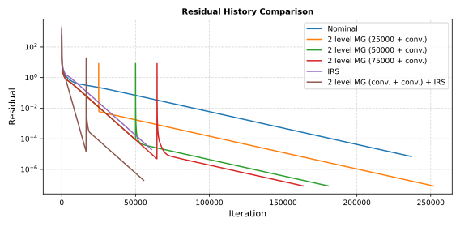

# Residual Convergence

**IRS and grid sequencing together reach steady state in 7× fewer iterations than plain RK3.** This
study compares the convergence accelerators of FUSS on a two-material plate with an exact solution:
implicit residual smoothing (IRS), grid sequencing on two levels, and both. None of them changes the
converged field.

Setup and run: `test/numerics-features/residual_convergence/README.md`. The FAS cycles are compared
on the same plate in [Multigrid Cycles (FAS)](fas-cycles.md).

---

## Problem

A plate of 1.0 m × 0.1 m in two blocks joined at x = 0.5 m by a block connection (101):

| Block | x (m) | k (W/mK) | ρ (kg/m³) | cp (J/kgK) |
|---|---|---|---|---|
| 1 | 0.0 – 0.5 | 10 | 8000 | 450 |
| 2 | 0.5 – 1.0 | 100 | 8000 | 450 |

The left end is held at 1000 K, the right end at 2000 K; the other faces are adiabatic. The plate
starts at 1500 K.

The two layers are resistances in series, so the heat flux is uniform:

$$q = \frac{T_\text{hot} - T_\text{cold}}{L_1/k_1 + L_2/k_2} = \frac{1000}{0.055} \approx 18\,182\ \text{W/m}^2$$

and the profile is linear in each block:

$$T(x) = \begin{cases} 1000 + 1818\,x & 0 \le x \le 0.5\ \text{m} \\ 2000 - 182\,(1-x) & 0.5 \le x \le 1.0\ \text{m} \end{cases}$$

## Strategies

Every run is steady RK3 on 100 × 10 cells per block, until the residual has fallen by 10⁻⁸.

| Case | VNN | IRS β | Levels | Coarse-level budget |
|---|---|---|---|---|
| nominal | 0.25 | — | 1 | — |
| irs | 1.0 | 0.5 | 1 | — |
| mg1 | 0.25 | — | 2 | 25 000 |
| mg2 | 0.25 | — | 2 | 50 000 |
| mg3 | 0.25 | — | 2 | 75 000 |
| mg_irs | 1.0 | 0.5 | 2 | 100 000 |

IRS smooths the residual before the update, which allows a larger VNN. Grid sequencing runs the
coarse level (50 × 5 cells per block) first, until its own residual has fallen by 10⁻⁸ or its budget
is spent. It then prolongates the solution once to the fine level, which runs to convergence.

## Result

Each run stops when its residual has fallen by 10⁻⁸ from the first residual of its finest level. For
grid sequencing that first residual comes after the prolongation and is already about 60 times
smaller, so those runs stop deeper. The last column compares the strategies at the same depth: the
first fine-level iteration with a residual at or below 3 × 10⁻⁵.

| Case | First residual | First fine-level residual | Final residual | Iterations | Iterations to 3 × 10⁻⁵ |
|---|---|---|---|---|---|
| nominal | 6.88 × 10² | — | 6.88 × 10⁻⁶ | 236 927 | 207 060 |
| irs     | 2.00 × 10³ | — | 2.00 × 10⁻⁵ |  60 855 |  58 802 |
| mg1     | 4.87 × 10² | 8.20 | 8.20 × 10⁻⁸ | 251 958 | 132 206 |
| mg2     | 4.87 × 10² | 8.23 | 8.23 × 10⁻⁸ | 180 608 |  61 094 |
| mg3     | 4.87 × 10² | 8.23 | 8.23 × 10⁻⁸ | 163 642 |  67 584 |
| mg_irs  | 1.42 × 10³ | 19.2 | 1.92 × 10⁻⁷ |  55 523 |  29 903 |

At the same depth (last column):

- **IRS alone is 3.5× faster** than plain RK3 (58 802 against 207 060). The larger VNN damps the
  smooth error faster.
- **Grid sequencing alone is 1.6× to 3.4× faster**, depending on how converged the coarse solution
  is. mg2 and mg3 hand over the same coarse solution: mg3's coarse level stops on its own threshold
  after 64 579 of its 75 000 iterations. The best grid-sequencing run is about as fast as IRS.
- **IRS with grid sequencing is the fastest**: 29 903 iterations, half of IRS alone and 6.9× fewer
  than plain RK3.

## Accuracy

All six runs converge to the exact profile; how close depends on where each stops:

| Case | Max \|T − Texact\| |
|---|---|
| nominal | 4.4 × 10⁻³ K |
| irs | 3.2 × 10⁻³ K |
| mg1 – mg3 | 5.3 × 10⁻⁵ K |
| mg_irs | 3.1 × 10⁻⁵ K |

No strategy changes the solution: the fields approach the exact profile as the residual falls.
