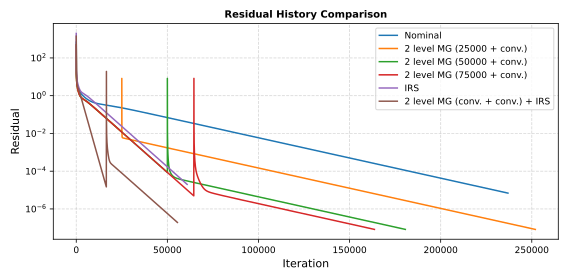

# Residual Convergence – Numerical Acceleration Strategies

Steady-state heat conduction across a two-material plate in the X direction. The physical problem is simple enough to admit an exact analytical solution, which makes it an ideal vehicle for assessing the convergence behaviour of different numerical acceleration strategies available in FUSS: baseline explicit RK3, implicit residual smoothing (IRS), and multigrid. Six configurations are compared — varying the IRS flag, the multigrid level-2 iteration budget, and their combination — all driven to the same residual threshold of 1 × 10⁻⁸ on the same 100 × 10 cells-per-block mesh.

---

## Problem setup

A rectangular plate (1.0 m × 0.1 m × 0.01 m) is partitioned into two material zones in the X direction:

| Block | X extent (m) | Material | k (W/mK) | ρ (kg/m³) | c_p (J/kgK) |
|---|---|---|---|---|---|
| Block 1 | 0.0 – 0.5 | mat1 | 10.0 | 8000 | 450 |
| Block 2 | 0.5 – 1.0 | mat2 | 100.0 | 8000 | 450 |

The two blocks are joined at x = 0.5 m by a block connection (101). No heat crosses the other faces (`null`).

**Boundary conditions**

| Face | Location | Condition | Value |
|---|---|---|---|
| Face 1 – Block 1 | x = 0.0 m | Prescribed temperature (302) – cold wall | T = 1000 K |
| Face 2 – Block 2 | x = 1.0 m | Prescribed temperature (302) – hot wall  | T = 2000 K |
| All other faces   | y, z directions | `null` (no flux) | — |

**Initial condition**

| Domain | T_init |
|---|---|
| All blocks | 1500 K (uniform) |

## Analytical solution

At steady state, the heat flux q is uniform and determined by the total thermal resistance of the two layers in series:

$$q = \frac{T_\text{hot} - T_\text{cold}}{L_1/k_1 + L_2/k_2} = \frac{2000 - 1000}{0.5/10 + 0.5/100} = \frac{1000}{0.055} \approx 18182\ \text{W/m}^2$$

The interface temperature is:

$$T_\text{int} = T_\text{cold} + q\,\frac{L_1}{k_1} = 1000 + 18182 \times 0.05 \approx 1909\ \text{K}$$

The temperature profile is piecewise linear in each block:

$$T(x) = \begin{cases} 1000 + 1818\,x & 0 \le x \le 0.5\ \text{m} \\ 2000 - 182\,(1-x) & 0.5 \le x \le 1.0\ \text{m} \end{cases}$$

## Cases and numerical setup

All cases use RK3 time-marching in pseudo-time (time-accurate = false) with primitive integration variables on the same 100 × 10 cells-per-block mesh (2 000 cells total) and are run until the energy residual drops below res-threshold = 1 × 10⁻⁸. The cases differ in IRS activation, multigrid activation, and the level-2 iteration budget:

| Case | VNN | IRS | IRS β | Multigrid levels | level2-iter |
|---|---|---|---|---|---|
| nominal | 0.25 | No  | —   | — | — |
| irs     | 1.0 | Yes | 0.5 | — | — |
| mg1     | 0.25 | No  | —   | 2 |  25 000 |
| mg2     | 0.25 | No  | —   | 2 |  50 000 |
| mg3     | 0.25 | No  | —   | 2 |  75 000 |
| mg_irs  | 1.0 | Yes | 0.5 | 2 | 100 000 |

IRS (Implicit Residual Smoothing) smooths the residual before the update, which allows a larger VNN. Multigrid is grid sequencing: level 2 (50 × 5 cells per block) runs `level2-iter` iterations, or until the residual reaches `res-threshold`; its solution is prolongated once to level 1, which runs to `res-threshold` (`level1-iter = 1 000 000` is only a cap). The coarse level is not visited again.

## Results

Residual convergence histories for all six cases are shown below.



Summary of iterations required to reach res-threshold = 1 × 10⁻⁸:

| Case | Initial residual | Final residual | Iterations |
|---|---|---|---|
| nominal | 6.88 × 10² | ~1.0 × 10⁻⁸ | 369 498 |
| irs     | 2.00 × 10³ | ~1.0 × 10⁻⁸ |  99 415 |
| mg1     | 4.87 × 10² | ~1.0 × 10⁻⁸ | 294 644 |
| mg2     | 4.87 × 10² | ~1.0 × 10⁻⁸ | 223 371 |
| mg3     | 4.87 × 10² | ~1.0 × 10⁻⁸ | 212 414 |
| mg_irs  | 1.42 × 10³ | ~1.0 × 10⁻⁸ |  79 816 |

**Key observations**

- **IRS** alone reduces the iteration count by ≈ 3.7× relative to the nominal RK3 run (369 498 → 99 415), because the larger allowable VNN = 1.0 effectively damps low-frequency error components more aggressively per iteration.
- **Multigrid** alone improves with a larger coarse-grid iteration budget: increasing `level2-iter` from 25 000 (mg1) to 75 000 (mg3) cuts the total iteration count from 294 644 to 212 414 (mg2: 223 371). Even the best multigrid-only case (mg3) remains less efficient than IRS alone (99 415): more than twice the iterations.
- **Combining multigrid and IRS** (mg_irs) yields the best result of all configurations, converging in 79 816 iterations — about 20 % fewer iterations than IRS alone and 4.6× faster than the nominal baseline.

All six runs reach the same solution: the final fields differ from the piecewise-linear profile above by at most 6.4 × 10⁻⁶ K (1.6 × 10⁻⁶ K with IRS). The iteration counts above are those of the current code (October 2026, `chimera-mpi` af13cab): `nominal` from the uncapped run of the FAS acceptance set (`fas_vv.md`, row `rc-nominal`), the others from the runs of the test suite gate; the field differences were computed from the `field.tec` of those gate runs (the `nominal` run is capped at 100 000 iterations there). *To be re-measured:* the residual histories in the figure above (`images/residual_convergence.svg`, from `SOLUTION/*.dat`) were recorded with earlier counts (369 089, 99 305, 294 094, 219 100, 144 106 and 80 603 iterations) and have not been regenerated (the counts differ by 0.1 % to 47 %, mg3 most).

```bash
cd test/numerics-features/residual_convergence/<case> && ./FUSS.sh solve   # one case
cd test/numerics-features/residual_convergence && python3 plot.py         # the figure, from SOLUTION/
```
- All six cases reach the same residual threshold of 1 × 10⁻⁸, confirming that none of the acceleration strategies compromises the converged solution.